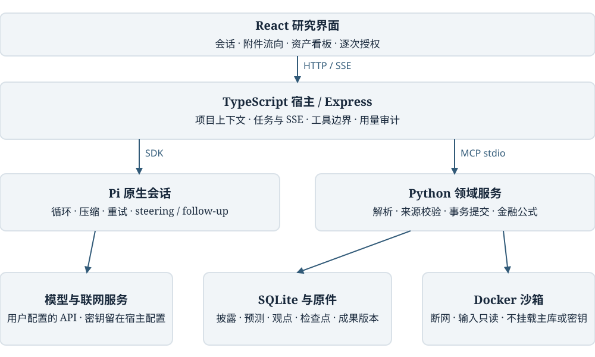
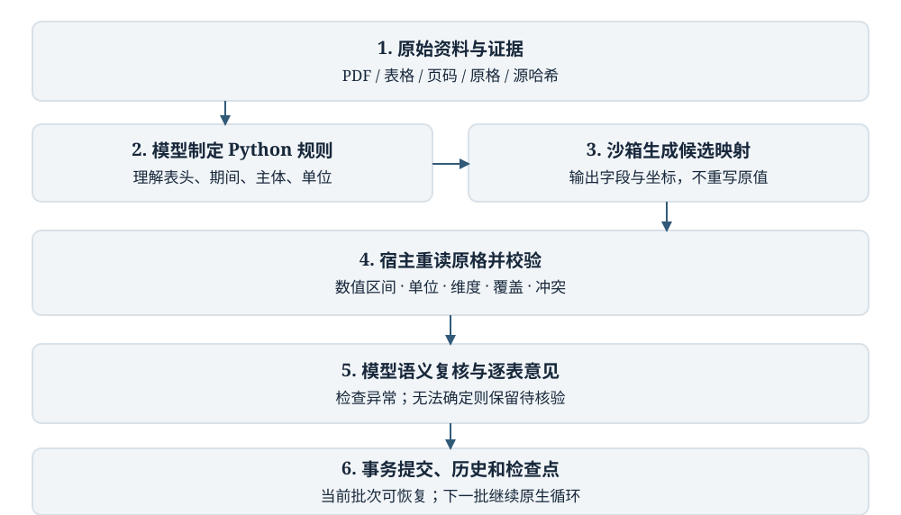

# 从财报问答到证据驱动的金融研究 Agent：设计、实现与工程演进

**Finance Agent v0.2.0 技术论文 · 2026 年 10 月 5 日**

**文稿性质：** 基于项目代码、开发记录和可复算验收证据的工程案例研究。作者署名与单位由项目所有者在正式投稿前确定。本稿未经过外部同行评审；应用发布版本与历史 benchmark 版本分别编号。

## 摘要

金融研究 Agent 的困难不只是从文档中回答问题，而是把具有不同主体、期间、单位、口径和信息时点的数据，转化为可追溯、可更新、可计算的研究资产。本文以 Finance Agent 的立项、功能构建和后续优化为对象，介绍一个面向财报与券商研报的本机研究系统。系统采用 React 界面、TypeScript 宿主、Pi 原生 Agent 会话、MCP 文档服务、SQLite 数据存储和受限 Python 沙箱。模型负责理解资料、制定映射、调用工具和复核语义，程序负责从原始坐标取数、执行确定性计算、检查提交条件并保存版本。开发过程显示，固定工具调用总次数、额外摘要参数、过早移除上下文以及逐条重新输出数据，会分别引起长任务停止、恢复失败、重复读取与较高输出成本。本文说明如何收敛这些宿主限制，并通过业务检查点、稳定请求前缀、最低 low 的推理路由、脚本清洗和分阶段用量记录处理相应问题。

在一份 57 页中报和一份 38 页公司研报的可见会话验收中，系统分别完成 50 张和 23 张候选表的处理结论，并覆盖研报全部 38 页正文；定向修复后保存 612 条披露事实、998 条研报数值和 78 条观点。49 个原文金额锚点与 78 条观点原句定位通过检查；三个金融模型经业务修正后通过 75 项独立复算。首次财报与研报处理的输入加权缓存命中率分别为 93.48% 和 98.19%。这是一组有定向反馈的工程验收，不能推断未见报告的总体准确率，也不能证明金融判断完全正确。案例表明，垂直 Agent 的专业性应主要体现在数据语义、证据约束、计算工具和业务复核，而不是不断重写通用执行框架。

**关键词：** 金融研究 Agent；财报清洗；工具调用；Pi；证据追踪；上下文压缩；提示缓存；金融建模

## 1 引言

设想研究者提出一个看似简单的问题：“公司净利润转正了，为什么经营现金流还是负的？”如果系统只把年报切片后交给语言模型，它可能找到净利润与现金流两个数字，却忽略现金流累计期间、合并范围、公允价值收益、非经常性项目以及单位差异。如果继续要求做 DCF，错误还可能沿着 EBIT、税率、营运资本和净债务桥传播到每股价值。文本回答正确与研究过程可靠，是两个不同的验收目标。

项目最初围绕财报解析、取数问答和证据定位展开，随后逐步加入完整表格清洗、财务口径复核、联网来源保存、估值模型、项目与会话组织、逐次授权、技能扩展及研报版本管理。随着任务从单次问答延伸到几十页甚至数百页材料，早期为便于控制而加入的工具次数、摘要长度和上下文裁剪限制，反而成为任务失败的主要来源之一。用户据此提出明确原则：不能因为大任务复杂，就用限制任务规模来获得小样本上的稳定。

本文围绕三个工程问题展开。第一，如何在保留通用 Agent 执行能力的前提下增加金融领域约束？第二，如何让模型少做重复转写，多通过工具完成清洗与计算？第三，如何让“已处理”“有证据”“通过复核”和“已保存模型”成为不同且可观察的状态？本系统的贡献是这些机制的实际组合、失败案例及验证边界，不是提出新的基础模型、全新 Agent 主循环或金融估值理论。

## 2 相关技术与设计取舍

ReAct 研究了推理与动作交替执行的任务组织方法 [1]。本项目采用的基本行为同样是读取证据、调用工具、观察结果、修正下一步，但没有把一段提示词本身视为可靠性保证。具体执行交给锁定版本的 Pi SDK；当前依赖为 `@earendil-works/pi-ai` 和 `@earendil-works/pi-coding-agent` 1.0.0。Pi 的会话、工具执行与持久化接口构成底座 [2]。DeepSeek Harness 官方压缩能力的组件划分为本项目审视“哪些事情应由框架负责”提供了参照 [3]；系统没有同时引入第二套 DSH 执行内核。

检索增强生成将外部检索与生成结合，适合为回答提供文档依据 [4]，但检索结果不能自动变成干净的财务事实。财报中的 2025 年收入、研报中的 2025E 收入以及报告发布日期，必须是不同字段。本文因此采用结构化事实、带版本的研究记录和文本检索并存的方案，而不是将所有内容都放入一个无差别向量库。

MCP 的宿主、客户端和服务端分工，使 Agent 编排与领域工具可以独立演进 [5]。本系统使用 stdio 连接本地 Python 服务；浏览器只访问本机 TypeScript API，不直接获得数据库连接。SQLite 提供嵌入式存储与 FTS5 关键词索引 [6]。向量与融合排序接口属于可选能力，本轮真实验收没有启用外部 embedding 服务。

工具选择遵循两个实际约束。一是本机安装和迁移成本：一个 Windows 便携目录比部署多种数据库服务更容易验收。二是财务结果必须能回查原文、重新计算和进行版本比较。对当前单用户规模，SQLite、文件型原件与成果记录已经能支持这些要求；未来若扩展到团队并发，才需要重新评估数据库、身份认证和任务调度。

## 3 立项目标与功能演进

### 3.1 从问答原型到研究过程

早期目标是解析 PDF、CSV、Excel 等资料，查询财务指标，并在回答中附上来源。历史材料保存了原型与冻结问答评测、原生无框线表格、跨页续表、中文字符往返、口径定义和估值工作流的迭代。历史六阶段需求台账保留了未完成项，不能因为后续发布应用版本而将这些需求全部改成通过。[E1]

这些工作最终形成更清晰的对象层级：项目持有可共享的资料和研究资产；会话记录一次研究意图及其执行过程；附件流向解释本次会话怎样使用、处理或复用资料；资产看板展示已经入库或保存的结果。一次会话可以引用已有数据，不必再次上传；一个文档也可能由后续会话定向修复，因此会话过程与文档当前状态不能混为一谈。

### 3.2 演进阶段

| 阶段 | 主要问题 | 增加或调整的能力 | 应保留的边界 |
|---|---|---|---|
| 早期原型与冻结问答评测 | 只有答案，难判断取数和引用是否正确 | 文档来源、确定性计算、答案与证据分别评分 | 旧成绩对应旧代码与旧测试集 |
| 完整财报处理 | 无框线表、续表、单位与期间混淆 | 原始表坐标、语义映射、定义与期间复核 | 不能只验收三张主表 |
| 项目化研究界面 | 文件入口、队列、成果概念重叠 | 项目下嵌会话，附件流向作为核验辅助 | 不是通用资料管理系统 |
| 权限与专业能力 | 通用删改权限与研究步骤混杂 | 逐次授权、项目约定、金融技能、Python/CSV 建模 | 技能不能替代权限执行器 |
| 长任务与成本优化 | 摘要截断、次数上限、重读、缓存不透明 | 收敛 Pi 接入、检查点、推理路由、脚本清洗、用量明细 | 仍保留安全和用户预算边界 |
| 财报与研报统一研究 | 预测归属、版本、多公司内容无处保存 | 共享解析与映射、研究记录、时点查询、统一资产看板 | 预测不能冒充公司披露 |
| v0.2.0 发布 | 本机源码与便携安装状态容易混淆 | 锁定依赖、版本一致性、启动指南、可校验发布包 | 发布包不携带个人数据 |

阶段并非独立的线性瀑布。界面验收会暴露数据库问题，建模会暴露财务口径问题，部署会暴露子进程和路径问题。本文按问题归纳这些反馈，不把它们改写为一次设计就全部正确的过程。

### 3.3 核心准则

第一，通用执行与金融规则分开。框架负责循环、压缩、重试和消息调度，金融层负责指标口径、来源、数值检查和模型计算。第二，模型承担语义判断，确定性工具承担可重复计算。第三，已完成工作落盘，不能只存在于一次模型摘要中。第四，安全限制约束具体动作和资源，不以全任务固定步数替代。第五，用户必须能看到错误、疑点、费用和修改来源。

## 4 系统结构与技术构成

### 4.1 Web 界面与 TypeScript 宿主

React 19、TypeScript 与 Vite 构成前端。界面包括项目树、会话、划选引用、输入区授权卡片、附件流向、资产看板和配置页。资产看板由已保存数据驱动，打开页面不需要再请求模型为每个卡片生成说明。

Express 宿主提供本机 API，负责项目上下文、配置、任务生命周期、SSE 事件、模型运行时、工具白名单、授权和结果保存。服务默认绑定 `127.0.0.1:3001`，当前设计不提供公网账号、团队角色或多租户服务。启动保护同时检查端口与数据目录所有权，防止两个进程同时操作同一运行目录。

Pi 会话负责模型与工具的迭代。宿主将可用金融工具、启用的技能和项目约定注册到会话，并把状态转成界面事件。模型目录使用 Pi 的原生目录与用户全局配置；应用自身的地址、密钥覆盖在内存中处理，不反向改写全局目录。对于目录中没有定义的兼容端点，仍保留显式配置入口，但不能假设任意网关都支持相同的推理协议。

### 4.2 Python 文档与领域服务

Python 3.12 服务承担文档解析、原始页面与表格保存、标准化、来源检查、事务提交、检索和金融模型计算。主要依赖包括 PyMuPDF、pdfplumber、pandas、openpyxl、RapidOCR/ONNX Runtime 和 MCP。历史语义清洗路径仍保留 LangExtract 相关代码与依赖；新的默认财报流程使用脚本映射，不应将依赖存在误写为每次任务都由该依赖执行。

原件保存与结构化结果分离。页面文本、几何位置、原始单元格和源文件哈希构成证据底层。模型错误的指标判断可以修订，而原文不能被静默改成符合期望答案的内容。金额运算使用十进制或明确的数值转换，避免只依赖自然语言大数运算。

### 4.3 受限计算环境

模型编写的清洗脚本和自由 Python 分析进入 Docker 沙箱。默认运行配置包括断网、根文件系统只读、非 root 用户、移除 Linux capabilities、禁止提权、2 CPU、2 GiB 内存、64 个进程上限及单次最长 120 秒。输入目录只读，输出单独保存，主数据库和模型密钥不直接挂载。长工作通过多个任务批次完成，不把单次容器时限等同于整个研究只能持续两分钟。

该边界的意义是限制不受信任代码的影响范围。它不证明生成的金融代码正确，也不能保证容器引擎没有漏洞。输入校验、结果核对、权限执行和财务复核仍须存在。没有 Docker 时返回能力不可用，不自动退回宿主执行任意代码。

### 4.4 核心模块映射

| 职责 | 主要实现位置 | 稳定契约 |
|---|---|---|
| 会话执行与恢复 | `server/runs.ts`、`session-recovery.ts` | 原生会话、任务状态、消息与工具回执 |
| 模型与思考路由 | `model-runtime.ts`、`reasoning-routing.ts` | 同一模型路由，提供商能力适配 |
| 文档解析与处理 | `service/parser.py`、`processing.py` | 原件、页面、源表、批次检查点 |
| 脚本清洗 | `script_cleaning.py`、`cleaning_sdk.py`、`semantic.py` | 映射、原格取数、提交核验 |
| 研究数据 | `research_ingestion.py`、`research_checks.py` | 来源归属、版本、期间、发布日期 |
| 展示与计算成果 | `AssetDashboard.tsx`、`ResearchWorkspace.tsx` | 对象过滤、来源、参数、结果和修订 |
| 可观察性 | `server/usage.ts`、`UsageFooter.tsx` | 输入、缓存、输出、思考、未知请求 |

## 5 数据模型：把文本变成可核验的研究资产

### 5.1 财务事实不是一个裸数字

一个可用于研究的事实至少需要主体、指标、期间、口径、币种、单位、业务维度、来源与质量状态。可以用如下概念元组表示：

`F = (project, document, entity, metric, period, scope, currency, dimensions, value, source, revision, quality)`

这个元组是概念模型，不表示所有字段都在一张表中以同名列实现。系统的 `facts` 保存主要查询字段，来源、规范化细节和维度可位于 JSON 元数据；修订历史、指标目录与处理记录由相关结构关联。可扩展性来自关系字段与受校验 JSON 的组合，而不是让模型任意创造无法查询的字段。

相同的“收入”标签可能指集团营业收入、某个分部收入或净额佣金收入。年份相同也可能分别是年末时点、半年累计或季度单期。若唯一性判定只使用指标名与年份，就会把不同业务值去重，或把重述数据与旧值混合。因此范围、维度、期间及来源版本必须进入查询和冲突判断。

### 5.2 三层数据与两种版本

| 层次 | 主要对象 | 用途 |
|---|---|---|
| 原始证据 | documents、pages、source_tables、文件哈希与坐标 | 回查原文与重放取数 |
| 语义记录 | facts、document_profiles、research_entities、research_records | 统一查询披露、预测、统计和观点 |
| 过程与成果 | processing_runs、normalization_batches、research_page_reviews、analysis_jobs、app_state | 进度、任务、会话、计算成果和版本 |

研报版本需要区分“新报告”和“旧报告提取修订”。机构在另一个日期发布的新预测是一条新来源；系统修正旧 PDF 的单位或提取错误，则形成该来源的修订。`is_current`、`supersedes`、资料 profile revision 和源哈希共同避免旧提取残留出现在当前看板中。只保存最后一个值，会丢失预测变化；把旧提取也显示为另一家机构的独立意见，同样会误导用户。

资料的发布日期和预测所指的期间是两个不同时间轴。例如 2025-07-16 发布的报告可以预测 2026 年利润。“截至 2025-07-15 能知道什么”应按发布日期过滤，而不能因为预测期间是 2026 年就纳入该报告。日期不明的资料不应悄悄参加明确截止日查询。

### 5.3 研报路由与正文证据

系统登记 financial_report、broker_research、industry_research、mixed 等资料类型，并为多研究对象建立关联。正式财报进入披露事实；券商文档中的历史引用、分析师预测、公司指引、行业统计、假设和未分类数值进入研究记录。观点还保存提出者、原句、页码、风险或催化剂类别等信息。多公司内容按每条记录所属对象映射，不沿用“一份文档只有一个公司”的假设。

财报与研报共享解析、脚本执行、原格取数和数值核验。同一张表中 2024A 与 2025E 只需生成一份映射，记录性质决定提交去向。正文则单独登记页覆盖，防止“表格已完成”掩盖没有处理的二十页文字。图形、单位不明或时间不明的内容保留疑点；没有可靠数字证据时，不用猜测填满表格。

### 5.4 检索与看板

结构化查询适合明确指标、期间和口径；全文检索适合寻找风险描述、会计政策与证据原句。向量检索若启用，必须沿用项目、发布日期和有效修订过滤，再参与融合排序，不能在结构化查询之外另开一条绕过过滤的通道。

统一资产看板是数据投影，不是另一套入库数据库。它在一个 SQLite 读取快照内汇总对象与卡片，提供公司/行业范围、截止日、同序列最新预测、观点和模型。财报看板与研究成果导航合并后，已有资料可以立即显示；只有真正保存的模型才出现为成果。精确来源可以带入会话草稿，是否发送仍由用户决定。

## 6 长任务执行：框架状态与业务进度分别持久化

### 6.1 固定步数为何不适合完整财报

清洗几十张表通常需要读取表头、生成映射、运行脚本、检查异常、提交和复核。一个任务超过 64 次工具调用并不自动表示失控。早期宿主按累计次数截断，会让尚在持续推进的任务停止；将阈值改成另一个更大的数字，只是延迟同类问题。

后续实现移除工具总次数硬上限，沿用 Pi 原生循环。有工具调用或途中引导时继续；用户停止、明确预算、无法恢复的服务错误以及单次工具安全限制仍有效。受控验收用两组各 137 次工具调用验证长循环，其中一组发生原生压缩。这验证框架路径，不能替代 137 次真实金融判断的正确性验收。[E2]

### 6.2 一套上下文策略

早期问题不只是上下文窗口偏小，还包括宿主单独覆盖摘要输出、只允许一次摘要重试，以及按工具结果年龄主动丢弃内容。后者会让仍在分析中的数值不再可见，模型只好重新查询。返回“之前读过”的回执也不能代替模型当前需要的数据。

当前使用统一的 Pi 压缩机制。宿主根据模型窗口配置预留与近期保留预算，自动目标约在窗口 80%，近期预算约为可用部分 16%，并受最大输出和安全余量约束；这不是声称每次都恰好在 80% 触发。金融扩展仅提示摘要保留主体、期间、单位、来源、模型版本和未完成事项，记录压缩事件，不另外接管摘要生成或重写清洗/分析两套上下文算法。

长窗口只能推迟压力，不能代替压缩。前缀缓存能降低重复输入的计价，也不能让超长会话无限增长。系统因此同时保留完整持久会话和受窗口约束的工作上下文；关键金融结果另存到数据库或模型成果中，以可查询的对象身份继续使用。

### 6.3 检查点的职责

业务检查点记录哪些表或正文页已处理、哪些有疑点、下一步需要什么，以及对应源哈希和结果。它不负责替代 Pi 管理会话，也不应成为另一个按业务类型改写上下文的机制。

一张表提交后，模型即使忘记之前的详细过程，也可读取检查点与保存结果继续。重复提交通过幂等和版本条件核对；原文变化或目标表被更新时，旧映射不能无条件重放。任务恢复先核对已提交回执，不能把所有历史工具调用都再执行一遍。

### 6.4 途中消息与重启恢复

执行中用户的新消息通过 `steer` 进入当前任务，排队消息通过 `followUp` 在当前任务结束后处理。消息先持久化，再进入原生队列。重启时只恢复尚未结束的 queued/running 任务，不自动重跑用户已经取消或历史失败的全部任务。

若 Pi 已保存最终回答，宿主采用该回答，不再额外生成一次。若写操作结果未知，则检查数据库和审计，不能凭“可能失败”直接重试。高权限操作若需要重试，应重新形成明确请求和授权。业务连续性不是忽视余额不足、认证失败或长期断网；这些状态必须被如实保留。

## 7 从逐条输出到脚本清洗

### 7.1 旧路径的成本来源

结构化 LLM 清洗让模型为每一行重复输出指标、期间、单位、口径和数值，随后目录、期间与单元格复核又会重复观察相似内容。即使模型正确完成转写，输出 token 仍可能很大；推理 token 又通常包含在输出用量中。单纯降低输入大小并不一定降低主要成本。

早期尝试直接关闭思考，在三大报表样本上表现尚可，却在复杂附注出现期间和范围误判，并错误跳过财务表。用户因此明确要求最低 low，疑点允许 high。这里的经验不是“所有清洗都必须昂贵推理”，而是把推理预算降到破坏语义判断的程度不可接受。

### 7.2 新流程与工具契约

新流程依次完成以下动作：解析原件并提供源表；模型读取表头与必要上下文；通过 `run_cleaning_script` 编写 Python 映射规则；沙箱执行并保存候选映射；宿主重读原始坐标取数；模型通过 `get_cleaning_result` 检查语义与异常；`commit_cleaning_result` 在检查通过后逐表事务提交并记录检查点。已经保存且哈希一致的同项目脚本可以被引用复用。

重要区别是脚本输出“行列到字段”的规则，数值由程序从原始格重新取得。它减少重复转写，也便于检查遗漏行、数值子串和来源坐标。但脚本仍可能把正确原值映射到错误期间或主体，所以程序来源一致性只能证明“来自哪里”，不能自动证明“是什么意思”。

合并单元格可能包含多条逻辑记录，系统允许明确的数值区间和维度覆盖。例如同一原格中的两个分部收入不能拼成一个大整数，也不能由于指标相同而只留下第一个值。错误映射应返回可修复的问题，不能通过放松源数值校验来让任务变绿。

### 7.3 主体、单位、维度和覆盖检查

本轮实际看板验收发现，列映射使用 `dimensions_json`，而物化器只读取 `dimensions`；分部维度因此丢失，相同语义键下的后续数值被去重。修复采用显式别名解析、冲突拒绝和更完整的身份字段，并使同一语义位置的不同数值报错。通过现有映射定向修复 12 张表，恢复 40 条记录，事实数由 572 增至 612。[E5]

这不是简单“缺个字段”的小界面问题。它揭示脚本 SDK、校验器和数据库必须共享同一语义契约。某个金额与原文完全一致，仍可能因维度丢失而在查询中不可用；只核对总入库数量，也可能错把重复数据当成完整覆盖。验收需要同时检查金额、单位、期间、维度、覆盖和查询结果。

### 7.4 推理路由

任务路由由所配置模型判断清洗、分析、建模或一般交互；路由本身使用低开销请求，清洗在传输边界最低提升到 low，复杂疑点可以局部 high。建模和财务解释使用更充分推理。复合任务先低强度处理材料，完成后进入分析强度，不要求清洗阶段把所有后续估值推理都带在上下文里。

该实现是请求参数和阶段的适配，不是训练了另一个路由模型。提供商可能只支持部分推理档位；必须核对实际发送请求，不能只看设置页显示“low”便宣称已生效。路由失败时保留足够的分析推理，普通清洗的最低要求仍不降低。

## 8 成本优化与可观察性

### 8.1 稳定前缀

DeepSeek 官方说明缓存依赖已持久化的匹配前缀，缓存有最佳努力性质；命中输入不代表模型输出免费 [7]。项目早期将动态指标目录置于固定示例之前，导致相邻请求很早出现差异。修复把固定规则和示例放在前部，变化目录、当前表与修复反馈放在后部。它改善可复用性，但不承诺每次请求达到固定命中率。

同样需要避免提示模板、工具定义和序列化顺序无意义变化。保留一套原生会话比不断重建聊天更有利于复用历史，但不能为缓存而拒绝必要压缩或继续发送无用结果。优化目标是完成任务的总成本与质量，而不是单独追求命中率数字。

### 8.2 输入、输出与费用的计量

设第 i 次请求的缓存输入为 H_i，未命中输入为 M_i，输出为 O_i，对应每百万 token 价格为 p_h、p_m、p_o。输入加权命中率与估算成本为：

`R_cache = sum(H_i) / sum(H_i + M_i)`

`C_est = sum(H_i * p_h + M_i * p_m + O_i * p_o) / 1,000,000`

不能直接平均每次请求的百分比，因为一个小请求和一个百万 token 请求的权重不同。推理 token 是输出的子集时，不再次加入 O_i。提供商未返回 usage 的失败或取消请求应计为未知，不能当作零费用。审计按请求身份去重，并按清洗、复核、分析、路由和压缩等阶段汇总。

界面在每个已结束任务下显示这些信息。估算价格来自配置或模型目录，账户折扣、时段、币种和实际结算仍可能不同。论文以记录中的价格区间复现历史费用，不将它描述为发布时所有用户都能获得的固定报价。

### 8.3 避免不成立的降本结论

十类伊利同源样本的历史比较中，保留 low 的压缩映射、完整续表取证和局部 high 修复组合，清洗及期间复核已知费用从 0.13070 美元降到 0.09672 美元，约下降 26.0%；组合后 413 项样本检查通过。[E3] 这是多项改进一起变化的开发比较，并非随机对照或单因素消融。它不能证明某一个修改独自产生 26% 降幅，也不能把十个片段当成整份财报。

脚本清洗后的 57 页中报与此前长篇伊利年报在篇幅、结构和调用配置上不同。因此即使成本明显更小，也不能据此计算“新架构相对旧架构每份财报节省多少百分比”。本论文将可复算的 token、缓存和请求数作为个案结果保留，同时承认缺少同材料、同版本、多次运行的严格对照。

## 9 金融能力如何作为领域扩展存在

### 9.1 技能、项目约定与工具

系统在每个项目加载用户启用的 `agent.md` 和技能。内置方向包括金融建模、模型复核更新、供应链分析和研报入库。技能提供步骤、概念边界与检查要求；真正的计算、数据库变更和文件输出由工具执行。Excel 是一种交付载体，不是这些金融方法的必要条件；本项目采用结构化参数、Python/CSV 和页面展示，不要求用户安装 Excel。

例如供应链分析可以从行业证据、上下游关系、成本构成与价格传导逐步形成情景，但当前样本并未独立验证完整供应链冲击模型。技能文件存在，只证明可加载的工作指导，不等于已完成该专业方向的大规模验证。

### 9.2 财务质量与 DCF 的确定性计算

财务质量模型比较收入、毛利、经营利润、净利润与现金流，并形成利润变化桥。桥接必须与原表小计定义一致：若营业利润已经包含财务费用，另扣一次会重复；若财务费用列于小计之后，就不应为得到小计而扣除。程序可检查残差，模型仍须识别原表定义。

FCFF DCF 的核心关系可以写为：

`FCFF_t = EBIT_t * (1 - tax_t) + D&A_t - Capex_t - DeltaNWC_t`

`TV_T = FCFF_(T+1) / (WACC - g), with WACC > g`

`Equity = EnterpriseValue - NetDebt - NCI + NonOperatingAssets`

终值还可用稳定期增长与 ROIC 表达再投资需求。模型必须区分已披露数值、券商预测、由来源计算的值和用户/模型假设。有限三年预测不自动构成无限期稳定经营假设；账面少数股东权益作为价值代理、现金是否全部可用于抵债、非经营资产是否计入，都需要显式说明。

### 9.3 真实建模中暴露的问题

本轮瑞和模型首次把财务费用重复纳入利润桥；伊利模型将终值外推参数列得过于像来源事实。单纯计算检查并没有发现所有业务问题。原会话收到具体复核反馈后，修改原模型并保留版本；最终营业利润桥残差为零，75 项独立复算通过。

伊利基准情景使用 WACC 8%、永续增长 2%、终值 ROIC 12%；压力情景只将 WACC 改为 10%。结果分别为每股 23.7325 与 16.6744 元。这里使用 2025-07-16 研报演示 2024 年末估值，是事后能力测试，不能冒充当时可交易策略或当前目标价。基准企业价值约 83.96% 来自终值，反映结果对长期假设敏感；复算正确不代表假设合理或估值可靠。

这些教训被补充到金融技能中，而不是又向 Pi 主循环增加财务特例。金融专业性的增长应当让模型更懂得检查利润桥、EBIT 与资产桥，而不是让框架用更多任意阈值阻止模型继续工作。

## 10 开发问题、原因与修复证据

| 现象 | 已观察原因或机制 | 采取的措施 | 验证及剩余边界 |
|---|---|---|---|
| 财报处理中途停止 | 宿主总工具次数上限；摘要输出预算被单独覆盖 | 移除总步数截断，回归 Pi 压缩/重试，保存业务进度 | 长循环受控测试通过；余额和长期网络故障仍可中断 |
| 同一分析反复读取 | 旧工具结果过早按年龄移除，当前数值不再可见 | 取消第二套年龄裁剪，保留准确工具结果与可查询底稿 | 重读仍可能因资料更新或证据不足而必要 |
| 低成本试验质量下降 | 无思考在复杂附注误判期间/范围，误跳财务表 | 最低 low、疑点 high，补续表原文上下文 | 已验证片段不代表所有复杂附注 |
| 命中率低或费用看不懂 | 动态内容前置，输入缓存合并显示，思考成本不透明 | 固定前缀在前，分离缓存输入和各阶段用量 | 命中是服务商最佳努力；记录估算而非账单 |
| Docker 脚本似乎卡住 | MCP 子进程继承输入管道等生命周期问题 | 显式处理子进程输入、输出和错误回执 | 实际 MCP 到沙箱链路验证；不声称所有卡顿同因 |
| 并行清洗丢登记 | 多个脚本更新登记状态存在覆盖风险 | 持久登记与并发更新校验，保留脚本哈希 | 回归覆盖并行脚本与复用 |
| 合并格产生超大数或少数据 | 多数值拼接、子串范围错误、维度别名漏读 | 原格 numeric span、维度别名冲突拒绝、完整身份检查 | 修复 12 表恢复 40 条；复杂表仍待核验 |
| WSL 占用显著升高 | 容器生命周期、并发与缓存需分别诊断 | 限定任务资源、线程与容器回收 | WSL 总内存不能直接作为泄漏证明，缺少长期堆分析 |
| “项目资料”定位混乱 | 项目文件总览、处理队列和原文查看入口混用 | 合并到会话附件流向，保留当前任务快照与来源 | 尚未建设独立文档管理系统 |
| 研报处理完看板仍空 | 旧研究成果只展示保存模型，研报结构数据无展示入口 | 统一资产看板，按对象关联披露、预测、观点、模型 | 研报引用实际值仍不变成正式披露 |
| 金融计算数值可复算但解释错 | EBIT、小计、终值和资产桥假设混用 | 源定义核对、利润桥残差、假设分类、版本修订 | 75 项算术及选定语义检查不是完整投资审查 |
| 便携包健康检查与版本不符 | 版本写死在多个脚本，数据路径发生演进 | 从 package 统一读版本、明确迁移与启动目录 | 源码更新不自动重启已运行进程 |

表中仅将有观察证据的机制列为原因。对 OCR 底层崩溃、WSL 占用或网络中断，开发记录可能只有现象和有效缓解，不能据此反推未经测量的唯一根因。类似地，清理或重启遭遇执行环境审批拒绝属于交付操作未完成，不能伪装为应用已经执行了相应动作。

## 11 验收设计与结果

### 11.1 样本、环境与独立性

主案例采用瑞和数智 2025 中期报告 57 页，以及国信证券 2025-07-16 伊利深度报告 38 页。原件来源和 SHA-256 见公开样本清单 [E6]。两篇均为完整 PDF，未截取前几页作为“全文”验收。系统在新运行目录、空数据库和可见会话中执行，当前模型为应用保存的 DeepSeek Flash；没有在本批任务中切换备用模型。

验证分四层：批次/页是否都有处理结论；来源数值与坐标是否可重放；独立查看 PDF 选定锚点并核对金融语义；保存的模型是否可按输入独立复算。原文锚点不是脚本生成模型的标准答案输入。任务中发生了定向修复和业务反馈，因此最终结果不是“无人工干预首跑准确率”。这里的独立检查由工程脚本与开发者复核构成，也不等于盲审或双人标注。

### 11.2 覆盖与质量

| 指标 | 财报 | 研报 |
|---|---:|---:|
| 完整 PDF 页数 | 57 | 38 |
| 有处理结论的候选表 | 50/50 | 23/23 |
| 正文页覆盖 | 不用此项替代财务表覆盖 | 38/38 |
| 数值记录 | 修复后 612 条披露事实 | 998 条研究数值 |
| 观点原句记录 | 未设同类指标 | 78 条 |
| 预测或指引 | 不计入正式披露 | 470 条，为数值记录子集 |
| 明确保留的问题 | 6 张复杂表或叙述待核验 | 99 条记录待核验 |
| 独立原文金额抽样 | 34/34 | 15/15 |

候选表覆盖包括有理由排除的表头、封面等，不能解释为每张候选表都产生了金融数据。612 也不是全篇财报所有数字的理论总数；某些非结构化表述和复杂内容未完整提取。99 条疑点与 78 条观点不应从总记录中机械相减后当作“精确率分母”。本轮没有可靠的全量逐格 gold，因此不报告全篇 precision/recall。

78 条观点原句均可按位置找到，研报记录写入正式披露库为零。三个模型保存后经修正的 75/75 检查涵盖 FCFF、折现、终值、企业价值到股权价值、每股价值、WACC 单因素一致性、利润桥和选定来源分类。[E5]

### 11.3 token 与估算费用

| 阶段 | 请求数 | 输入 token（含缓存） | 缓存比例 | 输出 token（含思考） | 估算人民币 |
|---|---:|---:|---:|---:|---:|
| 财报首次处理 | 78 | 10,862,737 | 93.48% | 126,115 | 1.416-2.832 |
| 研报处理 | 84 | 21,515,456 | 98.19% | 112,566 | 1.262-2.524 |
| 财报维度修复 | 8 | 3,300,192 | 94.73% | 6,428 | 0.262-0.525 |
| 三个金融模型 | 16 | 3,430,330 | 90.55% | 44,377 | 0.564-1.128 |
| 模型业务复核 | 6 | 1,974,444 | 97.81% | 27,142 | 0.190-0.381 |

合计 192 次请求，估算 3.6945-7.3889 元，本批没有缺失 usage 的请求。普通输入、缓存输入和其中思考的完整数字在汇总证据 JSON 中保留。金额差异是按配置价格区间估算，不是置信区间或账户账单。大量累计输入是多轮历史重复发送后的总量，不是报告独有 token 数，也不意味着单次请求超过模型窗口。

较短研报仍有较多累计输入，原因可能包括多公司表格、正文逐页检查、长会话历史和多个修复步骤。高缓存比例让重复输入较便宜，却不能消除输出、思考、工具往返和本机计算开销。下一轮优化应结合每阶段边际成本与质量，避免只看缓存百分比。

### 11.4 历史评测与本次发布检查

早期冻结 124 题三轮评测的答案正确数为 104、109、103，答案及证据同时正确数为 86、83、84；结论一致率为 112/124，即 90.32%。这些结果来自早期代码和题集，仍有未通过条件。[E7] 本文保留它们用于说明项目曾把证据质量与答案质量分开测量，不将其算作 v0.2.0 在相同题集上的成绩。

v0.2.0 发布准备阶段执行 167 项 Node 与 405 项 Python 服务回归，均通过；类型检查和生产构建通过。此前真实资产看板在 1440 与 390 宽度下验证导航、对象筛选、截止日、原文跳转、带引用草稿、图表、模型和 CSV 下载，无页面脚本错误。[E5, E8] 软件测试、来源检查、模型复算分别验证不同性质，不能简单相加后宣称几百次独立金融判断全部正确。

## 12 发布、复现与研究局限

### 12.1 可部署发布

v0.2.0 将内置 Node/Python、锁定的生产依赖、编译后的应用、专业技能、指南、论文和公开样本打包为 Windows x64 ZIP。构建器使用允许列表排除真实数据库、密钥、会话、虚拟机和开发缓存，生成逐文件 SHA-256 清单与包校验值。发布页提供源码标签、部署包和独立验证报告。

默认数据目录统一为 `data/active/`；旧 v0.1 使用过 `data/`，迁移必须先确认实际数据库位置。安装包不带开发机验收项目，用户按指南自行运行样本；汇总证据可以随论文保存，原始私人会话不随包发布。离线便携包验收通过 stdio MCP 检查内置环境、解析与重连，不另开本机应用测试端口；它不等于对新 ZIP 重新执行 HTTP 安装/停止或再次调用真实模型。实际范围以 Release 附件的验证 JSON 为准。

### 12.2 局限与有效性威胁

样本代表性有限。两篇完整 PDF 有助于观察端到端流程，但不能代表所有会计准则、扫描质量、表格版式和行业。锚点检查属于目的性抽样，对未抽到的附注错误缺少统计保证。模型曾接收针对失败的反馈，最终结果可能高于无人干预首跑水平。

语义检索与高级金融范围有限。真实 embedding 服务没有在本批启用，不能宣称向量检索改善了本次结果。供应链、三表和更多情景工具虽有实现或技能指导，本批主要验收财务质量与 DCF，没有覆盖全部方向。缺少独立金融专家对全部假设、税务口径和行业判断的审查。

成本与可靠性不能无限外推。费用依赖服务商、时段、网关、缓存持久化和模型输出；只记录已返回 usage 的历史样本。原生长循环提高持续执行能力，却无法保证上游余额、网络和本机资源始终可用。内存资源限制和容器清理是工程缓解，不构成长期无泄漏证明。

安全范围是本机单用户。项目隔离和逐次授权不等于企业级多租户隔离；数据库并非整体加密。提示注入、恶意文件、授权内容理解偏差和沙箱实现仍需要持续审查。资料中的文字是数据，不因为出现在 PDF、网页或技能候选内容里，就获得修改权限或覆盖用户请求的资格。

### 12.3 后续工作

后续应建立同报告、同模型、相同价格口径下的多次无干预对照，分离提示前缀、脚本清洗和局部复核各自的影响；扩展逐格标注与漏表检测，报告全量覆盖和语义错误分类；对长会话恢复、未知写操作和取消后资源回收进行故障注入；增加供应链情景、三表联动与估值假设的独立金融复核。所有新能力都应给出可回读的验收证据，再进入默认流程。

## 13 结论

Finance Agent 的工程演进说明，垂直系统的主要价值不是给通用模型设置更多停止条件，而是让模型所做的判断有明确的数据类型、来源、计算契约和可复核结果。通用框架保持循环与上下文能力，业务层通过原始坐标、脚本映射、事务检查点、时间版本和确定性金融工具增强专业性；界面则把这些能力变成用户能检查的过程和资产。

本案例已经验证两份完整资料到结构化资产、三个保存模型及统一看板的链路，同时暴露了维度丢失、利润桥重复计算和假设归类等重要问题。修复这些问题并保留失败证据，比把“任务结束”包装成“所有数据可信”更有研究价值。下一阶段的目标应是更严格、可比较的质量评测和金融专业验证，而不是再建一套与原生框架竞争的执行机制。

## 参考文献与证据索引

外部资料访问日期均为 2026-10-05；以下只用于说明相关工作与工具机制，本文实现与测量以代码和项目证据为准。

[1] Yao S, Zhao J, Yu D, et al. ReAct: Synergizing Reasoning and Acting in Language Models. ICLR 2023. https://arxiv.org/abs/2210.03629

[2] Earendil Works. Pi: AI Agent Toolkit; Coding Agent SDK. https://github.com/earendil-works/pi ; https://github.com/earendil-works/pi/blob/main/packages/coding-agent/docs/sdk.md 。本文安装版本为 1.0.0，在线主分支可能后续变化。

[3] DeepSeek. DeepSeek Harness: Compaction Capability Family. https://github.com/deepseek-ai/deepseek-harness/blob/master/packages/compaction/README.md

[4] Lewis P, Perez E, Piktus A, et al. Retrieval-Augmented Generation for Knowledge-Intensive NLP Tasks. NeurIPS 2020. https://arxiv.org/abs/2005.11401

[5] Model Context Protocol. Architecture, specification 2025-06-18. https://modelcontextprotocol.io/specification/2025-06-18/architecture

[6] SQLite. FTS5 Extension. https://sqlite.org/fts5.html

[7] DeepSeek API Documentation. Context Caching. https://api-docs.deepseek.com/guides/kv_cache/

[E1] 项目立项与交接：`goal_requirements.json`、`HANDOFF.md`、`design/history/work-status-original-handoff-v08-20261004.md`。台账中的未完成项保留，不用本稿覆盖。

[E2] 原生 Pi 接入：`design/pi-integration-audit-20261004.md`、`design/pi-native-integration-20261005.md`；复现测试 `tests/pi-long-loop.test.ts`、`tests/pi-native-integration.test.ts` 等。

[E3] 历史同源片段费用实验：`design/cleaning-cost-20261004.md`；长文滚动恢复记录 `design/rolling-ingestion-20261004.md`。同源样本与完整年报费用分别记录。

[E4] 脚本与研报实现：`design/script-cleaning-20261005.md`、`design/research-ingestion-20261005.md`。这些记录中的早期多端口部署为历史状态，当前统一 3001。

[E5] 本次端到端验收：`docs/evidence/v0.2.0/acceptance-summary.json`、`design/asset-dashboard-20261005.md`。JSON 保留金额锚点、模型检查、用量与原审计哈希，不包含密钥、会话全文或模型私有推理。

[E6] 样本来源与哈希：`samples/native-pdf/release-0.2.0-sources.json`。瑞和原件：https://www.hkexnews.hk/listedco/listconews/sehk/2025/0915/2025091500572.pdf 。伊利研报原件：https://pdf.dfcfw.com/pdf/H3_AP202507161710034181_1.pdf?1752687221000.pdf=

[E7] 早期冻结评测：`benchmark/results/agent-2026-10-03T06-37-06-859Z-summary.json` 与 `paper/README.md` 的历史部分；属于旧实现结果，不作本版性能承诺。

[E8] 本版软件回归：`docs/evidence/v0.2.0/regression-summary.json`；发布 ZIP 验证结果为 Release 的 `deployment-verification.json`。原始本机验收日志的哈希用于溯源，不表示这些私人运行目录随包分发。
