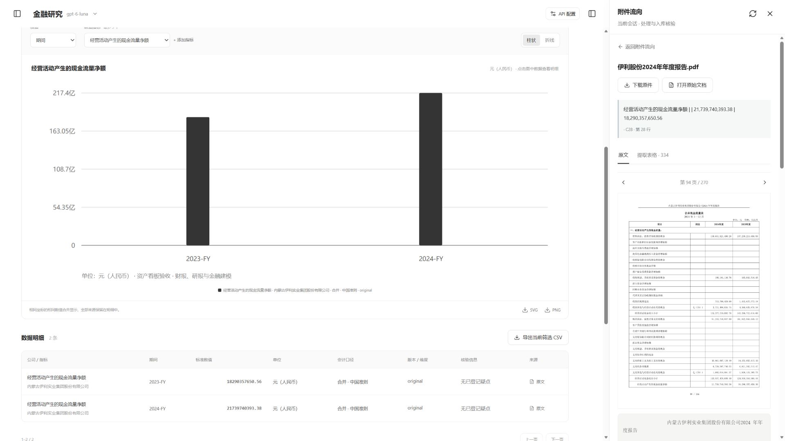
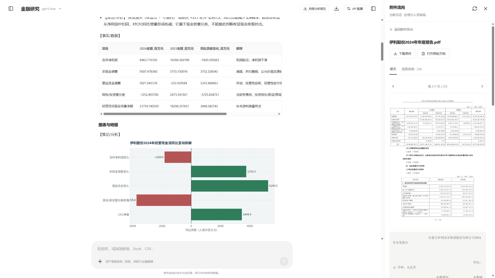
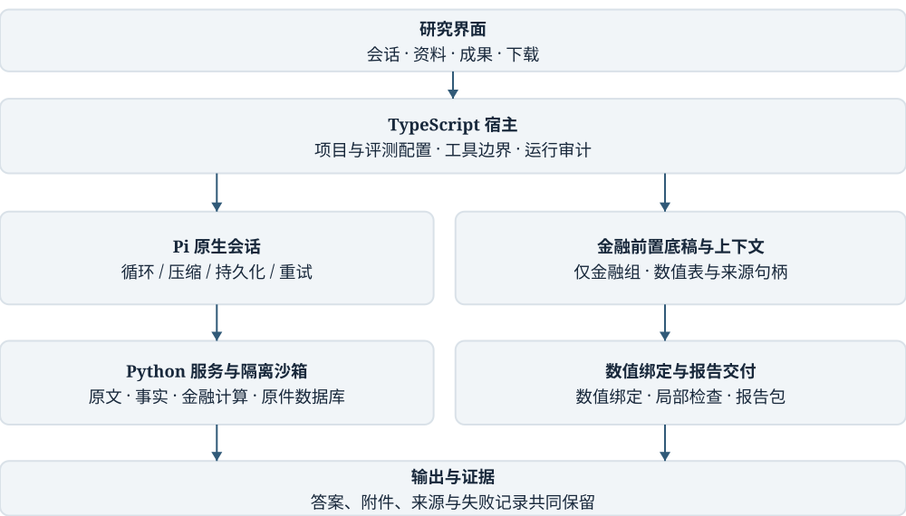

# Finance Agent：证据驱动的财报研究智能体

**2026 年北京市大学生金融人工智能竞赛 · 初赛项目计划书**

| | |
|---|---|
| 参赛方向 | ② 上市公司财务报告分析（兼顾 ① 数据结构化提取、④ 自动化估值建模） |
| 队伍名称 | 【队伍】 |
| 成员 / 指导教师 | 【队伍】 |
| 联系方式 | 【队伍】 |
| 作品形态 | 本机运行的 Web 研究工作台（Windows x64 便携包），附完整源码、运行说明与评测证据 |

<!-- pagebreak -->

## 一、项目概述

**一句话**：Finance Agent 让大模型像一位严谨的研究员那样读财报——每个数字都能回到原文页码，每一步计算都能复算，每份交付的文字、表格和图表彼此一致。

**要解决的问题**：大模型已经能读几百页的年报、也能写代码算数，但在真实财报分析中，它们常常"算对了数，却写错了结论"：把期间写颠倒、把方向写反、把图画错，或者给出没有出处的解释。研究员拿到这样的结果，必须从头再核一遍。

**我们的做法**：把财报分析拆成三层可检查的工序。

1. **资料变成资产**：年报经脚本清洗入库，每个数字都记录主体、期间、口径、单位，以及原文页码和表格坐标。
2. **先有底稿，再下结论**：用户提出财报分析问题时，系统先由程序算好利润与现金桥、变动归因、异常信号，并找出对应的管理层原文，交给大模型的是一份成品底稿。
3. **交付前自动检查**：所有计算在断网沙箱中执行，正文、CSV、Excel 和图表引用同一组数值；交付前检查方向措辞、期间顺序、瀑布图连续性和估值说明是否完整。

**目前的成果**：

- 系统已完成三个公开版本迭代（v0.1 → v0.2.0 → v0.3.0）和 v3 分析层开发，提供可安装的便携发布包。
- 完成了 162 回合的三组双盲正式评测（同一模型、同一题目，含一家开发期间从未接触过的新公司），两位独立评审的判断一致率达 96%–98%。
- **分析深度稳定领先**：开发集上，金融组的异常信号评分为 3.83 / 3.00（两位评审），原版通用智能体为 2.00 / 2.00；新公司测试集上，口径调整评分为 3.00 / 2.83，原版为 2.00 / 2.33。
- **在新公司上更少出错**：金融组有实质缺陷的回答为 6/18 和 7/18，原版通用智能体两遍均为 8/18。
- 评测同时暴露了下一步要解决的问题：金融层多做的分析，在开发集的估值类任务中带来了新的交付错误（材料范围、单位标签），输入成本也高于原版。这正是决赛前的改进重点。

## 二、痛点：一个具体的例子

伊利股份 2024 年报显示，合并净利润从 102.84 亿元降到 84.64 亿元，经营活动现金流却从 182.90 亿元增加到 217.40 亿元，多了约 34.5 亿元。为什么？

要回答这个问题，研究员需要翻到年报第 217–218 页的现金流量表补充资料，逐项核对折旧摊销、减值、投资收益、营运资金变动，再到管理层讨论里找原因（春节备货、经销商预收款），最后判断这种改善能否持续。答案散落在主表、附注和文字之间，而且每一步都有口径陷阱：合并还是母公司？归母还是整体？本期还是累计？

我们让通用大模型（同一个强模型、同样的资料）回答这类问题时，记录到的真实错误如下，全部来自盲评记录：

| 错误类型 | 真实实例 |
|---|---|
| 期间顺序颠倒 | 报告写"合并净利润由 8,463.7 降至 10,284.3（百万元）"，前后两期写反 |
| 关系方向写反 | 质保费用从销售费用重分类进营业成本后，毛利率与销售费用率**同向**下降 3.04 个百分点，报告却写"方向相反" |
| 图表几何错误 | 现金桥瀑布图的负值柱被重复下移一次，桥在图上"断开" |
| 序列错位 | 图中把归母净利润和经营现金流两个数值互换 |
| 单位失配 | CSV 中的数值是百万元，表头却标为亿元，相差 100 倍 |

这些错误有一个共同点：**数算对了，写出来错了**。模型的计算往往没问题，问题出在从计算结果到文字、表格、图表的"最后一公里"。这正是本项目要攻克的地方。

## 三、产品与应用场景

### 3.1 产品形态

Finance Agent 是一个在本机运行的研究工作台：

- **项目与会话**：一家公司或一个研究主题为一个项目，项目内的多个会话共享资料，不同项目相互隔离。
- **附件流向**：每份年报、研报被如何处理、存到哪里、被哪次分析引用，一目了然。
- **资产看板**：已入库的财务事实、研报预测、观点和保存的模型集中展示，任何数字都可以一键跳回原文所在页。
- **研究成果**：每次分析交付 Markdown 报告、CSV 与 Excel 底稿、图表和可复算的 Python 脚本。

图 1　资产看板：伊利经营活动现金流量净额 2023–2024 年数据，每个数字标明口径、单位和来源，右侧直接打开年报原文所在页。

图 2　一次财报分析的交付：经营现金流同比变动拆解的数据表与贡献图，右侧对照年报第 217 页现金流量表补充资料。

### 3.2 目标用户

| 用户 | 典型任务 | Finance Agent 提供的帮助 |
|---|---|---|
| 券商 / 买方研究员 | 年报季业绩点评、盈利质量判断 | 底稿先行，初稿附带完整来源和可复算脚本 |
| 企业财务与投资者关系人员 | 解释利润与现金流背离、会计口径调整影响 | 利润与现金桥、口径标记、管理层原文对齐 |
| 金融专业师生 | 财报阅读教学、案例复盘 | 每步计算可复算，典型错误可展示 |
| 进阶个人投资者 | 深度阅读单家公司 | 本机运行，原件与数据库不出本机 |

### 3.3 典型任务

- 业绩与现金流解释（利润为何下降、现金为何上升）
- 盈利质量与现金转化（非现金项目、营运资金、一次性损益）
- 会计政策变化的可比口径调整（如质保费用重分类对毛利率的影响）
- 异常信号识别与追问（季节性、备货、回款节奏、持续性判断）
- DCF 与相对估值的建立和局部更新

## 四、技术方案

### 4.1 系统架构

| 层次 | 技术 | 职责 |
|---|---|---|
| 界面 | React 19、TypeScript、Vite | 项目与会话、附件流向、资产看板、授权与用量展示 |
| 宿主 | Express（TypeScript）+ Pi 智能体框架 | 任务生命周期、上下文压缩与重试恢复、工具白名单、请求识别与底稿注入 |
| 领域服务 | Python 3.12，通过 MCP 协议接入 | 文档解析、脚本清洗、结构化事实、底稿流水线、金融模型、交付检查 |
| 存储 | SQLite（含全文检索）+ 原件文件库 | 事实与证据分层保存，研究成果带版本 |
| 计算沙箱 | Docker | 断网、只读根文件系统、非 root、2 CPU / 2 GiB、单次 120 秒，执行模型编写的代码 |

**推理引擎**：系统以大语言模型为核心推理引擎，通过 OpenAI 兼容接口接入，模型可配置。历史工程验证使用国产模型 DeepSeek；本轮三组对照评测为保证条件一致，三组统一使用同一模型（gpt-6-luna）。

### 4.2 对照竞赛的五个必备模块

| 竞赛要求的模块 | 本项目的实现 |
|---|---|
| 任务编排 | Pi 原生会话循环；宿主负责长任务检查点、断点续跑和中途消息 |
| 工具调用 | MCP 领域工具：原版通用组 10 个、同数据通用组 13 个、金融组 32 个 |
| 提示指令 | 稳定前缀的系统提示，加四类金融技能（建模、模型复核更新、研报入库、产业链分析） |
| 数据处理 | PDF 与表格解析、脚本清洗入库、必经底稿流水线、统一数值交付 |
| 日志记录 | 审计日志（JSONL）、逐请求用量账本、产物清单与 SHA-256 哈希 |

竞赛要求"数据来源可核验、执行过程可追溯、运行结果可复现"，我们分别用以下三类材料回应：原文页码与表格坐标；完整的工具调用与沙箱执行记录；冻结版本、冻结数据与可重放的沙箱脚本。

### 4.3 关键技术

**1. 脚本清洗，取代逐条转写。** 模型不逐个抄写数字，而是编写映射脚本，由程序按原始单元格坐标取数，并检查主体、期间、单位和维度后事务式提交。转写错误和输出 token 同时下降。

**2. 财务事实的数据模型。** 每个事实记录主体、期间、口径、维度、单位、来源页码与坐标、处理版本。研报预测与公司披露分库保存，预测永远不会冒充披露。

**3. 必经底稿流水线。** 我们在早期评测中发现："有工具"不等于"会用工具"——专门的变动归因工具在财报题中两次都没有被模型调用。v3 改为由宿主在模型推理前直接运行底稿流水线，产出：关键指标、利润与现金桥、主要变动的归因与管理层原文（附页码）、已触发的异常信号、口径未齐标记和缺失项说明。模型拿到的是成品，完整表格以句柄方式按需读取。

**4. 三层解释。** 先引用披露事实（管理层原话与页码），再量化影响（能算的算出来，算不了的写明缺什么），最后给出标注为"推论"的判断。"公司定性披露了但没有量化"与"原文没有说明"分开表述。

**5. 统一数值交付。** 每个数值只换算一次展示单位，CSV、图表和正文由同一组结果生成，杜绝"正文对、图错十倍"这类问题。

**6. 交付一致性检查。** 交付前自动扫描正文、CSV 和 Excel 中的方向措辞与带符号数值是否矛盾、"由 X 降至 Y"的期间顺序是否正确、"方向相反/同向"的关系断言是否成立，并对瀑布图做几何连续性校验；发现问题时把具体位置返回给模型修正。

## 五、创新点

**1. 程序先跑，模型拿成品。** 大多数金融智能体把专业工具交给模型"自行选用"，我们的实测证明模型并不会稳定地用。Finance Agent 把底稿作为必经流程：专业步骤由宿主保证执行，模型专注于解释和判断。金融规则放在领域层，不改动通用智能体的主循环。

**2. 攻克"最后一公里"。** 我们的错误分析表明，财报分析中的实质错误大多不在计算本身，而在计算结果写成文字、表格和图表的过程中。统一数值交付与交付一致性检查专门针对这一环节，并且每项检查都用真实失败样本验证命中、用历史正确交付验证误报（历史 70 份正确交付文本，误报 0）。

**3. 用三组双盲评测回答两个问题。** 我们不只和一个"被削弱的基线"比较，而是同时设置三组：

- **原版通用智能体**：通用提示与原始工具，代表"直接拿一个好模型来做"；
- **同数据通用组**：拿到与金融组完全相同的结构化资料和交付基建；
- **金融组**：在此之上增加金融底稿、金融工具和技能。

前两组之差回答"整套系统比直接用大模型好多少"，后两组之差回答"金融层本身贡献了多少"。评审由两位独立的匿名评审完成，第二位倒序评阅，分数封存后才揭盲；另有一家开发期间完全未接触的公司作为封存测试集。

**4. 用负面结果驱动迭代。** 每轮评测的缺陷都按来源归因：是金融层自己引入的、模型共性的，还是交付基建的。我们只修有证据的问题，门槛未达标时先诊断、不堆功能。下一节的迭代过程就是这一方法的实际体现。

## 六、评测与效果

### 6.1 评测设计

| 要素 | 设计 |
|---|---|
| 材料 | 开发集：卡罗特 2025 中报、伊利 2024 年报、海尔智家 2024 年报；封存测试集：一家新公司 2024 年报，开发期间未接触 |
| 题型 | 开发集：业绩与现金流解释、研报预测与 DCF、估值局部更新；新公司测试集：3 道新题；扩展题：现金桥与盈利质量、会计重分类与可比口径等 6 道已见题型 |
| 对照 | 原版通用智能体（10 工具）/ 同数据通用组（13 工具）/ 金融组（32 工具），同一模型 |
| 评分 | 读取、实质正确、业绩解释、口径调整、异常信号、交付质量六个维度（0–4 分），另计"实质缺陷" |
| 评审 | 两位独立匿名评审，第二位倒序；附件匿名化后逐件核对；分数封存后揭盲 |
| 成本 | 逐请求记录输入、输出 token；资料准备成本与分析成本分开计算 |

结论判定规则在正式评测开跑前写定：一个对比结论必须在两位评审的评分中**各自独立成立**才算成立，同时两位评审的逐案一致率不低于 80%。

### 6.2 迭代闭环：从发现问题到定向修复

**第一轮门槛（v3 初版，18 回合）**：金融组的解释深度与异常识别首次领先（异常信号评分 4.00 对 2.25），但有实质缺陷的回答仍为 3/5，与通用组持平。

**归因分析**：我们逐条分析了两位评审确认的全部缺陷机制，发现：

- 大部分错误三组都有，属于模型共性：手写瀑布图负柱错位、方向措辞写反、期间顺序颠倒；
- 只有一类是金融层自己引入的：底稿把"报告期内已完成的并表"误标为"不证明本期发生"。

**定向修复（v3.1）**：只修有证据的问题，不加新功能——修正底稿的事项判定规则，新增瀑布图连续性检查，把方向检查扩展到 Excel、期间顺序和关系断言。

**第二轮门槛（v3.1，18 回合）**：

| 指标（评审一 / 评审二） | 原版通用智能体 | 同数据通用组 | 金融组 |
|---|---|---|---|
| 有实质缺陷的回答 | 3/6、4/6 | 3/6、4/6 | **1/6、2/6** |
| 业绩解释评分 | 2.50、2.50 | 2.33、2.50 | **3.17、2.83** |
| 异常信号评分 | 2.50、3.00 | 2.50、3.00 | **3.33、3.17** |
| 方向类实质缺陷（条） | 2、2 | 3、3 | **0、0** |
| 已知输入 token（6 回合合计） | 235 万 | 382 万 | 291 万 |

两位评审各自独立评分，金融组在缺陷数量和分析深度上都达到了预设门槛。金融组的输入比同数据通用组少 24%，比原版通用智能体多 24%（原版不读取结构化底稿，分析更浅）；如果按"每个无缺陷回答"计算，金融组的投入低于原版通用智能体。

### 6.3 正式评测（162 回合）

正式评测分三组题：**开发集**（业绩解释、研报预测与 DCF、估值局部更新，每题每组 6 次）、**封存的新公司测试集**（3 道新题，每题每组 6 次）、**扩展题**（6 道已见题型，每题每组 3 次）。161/162 回合完成（1 回合为上游服务故障）。

**分析深度**（评分 0–4，评审一 / 评审二）：

| 维度与题集 | 原版通用智能体 | 同数据通用组 | 金融组 |
|---|---|---|---|
| 业绩解释 · 开发集 | 2.50 / 2.61 | 2.44 / 2.56 | **3.11 / 3.17** |
| 异常信号 · 开发集 | 2.00 / 2.00 | 1.67 / 2.00 | **3.83 / 3.00** |
| 口径调整 · 新公司 | 2.00 / 2.33 | 1.83 / 1.83 | **3.00 / 2.83** |

**交付质量**（有实质缺陷的回答 / 18，评审一 / 评审二）：

| 题集 | 原版通用智能体 | 同数据通用组 | 金融组 |
|---|---|---|---|
| 新公司测试集 | 8 / 8 | 6 / 6 | 6 / 7 |
| 开发集 | 12 / 11 | 8 / 8 | 12 / 12 |
| 扩展题 | 6 / 5 | 6 / 5 | 9 / 9 |

**怎么读这组结果**：

1. **结构化资料与交付基建本身就在减少错误。**同数据通用组与原版的主要区别，是拿到了我们准备的结构化资料和统一数值交付能力（没有金融底稿和金融工具）。它在开发集和新公司上的实质缺陷都明显少于原版（8 对 12/11，6 对 8）。这是描述性观察，不是预注册的主对比。
2. **金融层显著加深了分析，但多做的分析也带来了新的出错点。**金融组在开发集的缺陷集中在两类：估值任务中混入了题目已排除的期间内容，以及单位和币种标签在表格、图表间传递出错。这两类都是具体、可修复的交付问题，而不是分析能力不足。
3. **按预先注册的严格标准，整体优势尚未得到证实。**这个标准要求质量不更差、深度更高、成本不更高同时成立，并且在两位评审中各自成立。金融组在开发集的缺陷数和对原版的输入成本没有满足这一点，我们如实报告，不做事后调整。

**成本**：金融组的已知输入比同数据通用组在开发集上少 33%，但比原版通用智能体多（开发集 +116%，新公司 +33%）。原版不读取结构化资料、分析更浅，因此输入更少。

**可靠性**：两位评审在"是否有实质缺陷"上的逐案一致率为 96%–98%，Cohen's κ 为 0.92–0.96，全部分歧原样公开。

### 6.4 历史工程验收

| 验收项 | 结果 |
|---|---|
| 完整财报入库（57 页中报） | 50/50 张候选表有处理结论，612 条披露事实，独立原文金额抽样 34/34 一致 |
| 完整研报入库（38 页） | 998 条研究数值、78 条观点原句全部可定位，抽样 15/15 一致 |
| 金融模型（FCFF DCF 等） | 3 个模型、75/75 项独立复算通过 |
| 全流程模型费用 | 192 次请求，按 DeepSeek 计价估算 3.69–7.39 元人民币 |
| 软件回归 | 167 项 Node 与 405 项 Python 测试通过（v0.2.0 发布时） |

## 七、对照评审标准

| 评审标准 | 我们的设计 | 证据 |
|---|---|---|
| 任务完成度 | 完整入库不截断；长任务断点续跑；局部问题降级交付而不整轮作废 | 正式评测 161/162 完成，唯一缺失为上游服务故障，无人工补跑 |
| 数据与计算准确性 | 原格坐标取数；十进制运算；统一数值交付 | 75/75 模型复算；34/34 原文抽样；新公司上金融组实质缺陷 6–7/18，原版 8/18 |
| 分析逻辑严密性 | 必经底稿；三层解释；口径未齐标记进入答案约束 | 开发集业绩解释 3.11 / 3.17、异常信号 3.83 / 3.00，两位评审均领先 |
| 证据支撑充分性 | 事实到页码与坐标；管理层原文对齐；来源一键跳转 | 78/78 观点原句可定位；附件逐件核对 |
| 结果稳定性 | 每题多次重复；双遍独立评审；分歧全部公开 | 每题每组 6 次重复；评审一致率 96%–98%，κ 0.92–0.96 |
| 方案创新性 | 必经底稿、"最后一公里"检查、三组双盲评测、负面结果驱动迭代 | 两轮门槛与 162 回合正式评测的完整记录 |
| 实际应用价值 | 本机部署；成本按 token 计量可控；面向研究、财务、教学 | 便携发布包；逐请求用量账本 |

## 八、进度安排

| 阶段 | 时间 | 内容 | 状态 |
|---|---|---|---|
| 原型与冻结问答评测 | 2026 年 10 月初以前 | 财报解析、取数问答、证据定位、124 题冻结评测 | 已完成 |
| v0.1 / v0.2.0 / v0.3.0 | 10 月 4–6 日 | 便携发布、资产看板、脚本清洗、统一数值交付、技术论文 | 已完成 |
| v3 分析层与两轮门槛 | 10 月 8–9 日 | 必经底稿、深度解释、交付检查、定向修复 | 已完成 |
| 正式评测 | 10 月 9 日 | 162 回合三组双盲评测 | 已完成 |
| 初赛提交 | 10 月 18 日前 | 项目计划书、技术报告、介绍视频 | 进行中 |
| 决赛准备 | 10 月下旬至 11 月 | 修复正式评测暴露的交付错误、上下文瘦身、新公司复验、现场样例与答辩材料 | 计划中 |

决赛前有两个重点。第一是**修复正式评测暴露的三类交付错误**：宿主预计算和最终附件严格遵守题目给定的材料范围；单位与币种标签随数值一起传递，不在表格、图表间各写一遍；利润归属和收入口径不一致时，比较前先写明调节。第二是**上下文瘦身**：把已被模型读取过的大块工具结果替换为摘要与可重读句柄，精简金融组的系统提示和工具说明，目标是在质量不下降的前提下，使金融组的输入不高于原版通用智能体。

## 九、推广与应用前景

- **开源本机版**：Windows 便携包，解压即用；用户使用自己的模型 API Key，按实际 token 付费，项目不托管任何用户数据。
- **教学版**：用公开财报样本和真实错误案例，展示"错误是怎样被发现的"，适合财报分析和金融科技课程。
- **机构私有部署**（后续）：将本地数据库升级为服务端数据库，增加组织权限、审计与配额；数据层与模型层分离，便于对接机构内部数据源和国产模型。

## 十、风险与应对

| 风险 | 现状 | 应对 |
|---|---|---|
| 新增分析带来新的出错点 | 金融层加深了分析，但开发集估值任务中出现材料范围越界、单位标签传递错误 | 材料范围约束进入宿主预计算；单位与币种标签随数值绑定；修复后按同一协议在新公司上复测 |
| 成本 | 金融组输入低于同数据通用组（开发集 −33%），但高于原版通用智能体 | 决赛前完成上下文瘦身并按同一协议复测 |
| 评测的代表性 | 开发集三家公司、封存测试集一家公司，评审为模型评审 | 增加行业与公司样本；引入金融专业人员人工复核 |
| 评审一致性 | 两位模型评审在少数案例的严重程度上存在分歧 | 结论须两位评审各自成立；分歧全部公开；补充评分细则判例 |
| 数据安全 | 原件与数据库存本机，代码在断网沙箱执行 | 发给模型服务的仅为任务所需片段；支持切换为私有部署模型 |
| 第三方组件许可 | 已列出主要组件及许可证 | 发布前逐项核对，见 `THIRD_PARTY_NOTICES.md` |

## 十一、团队与资源

| 角色 | 成员 | 主要职责 |
|---|---|---|
| 项目负责人 / 金融方法 | 【队伍】 | 需求、会计口径、结果解释 |
| 系统与数据工程 | 【队伍】 | 资料处理、宿主、底稿流水线、交付 |
| 评测与证据 | 【队伍】 | 题集、盲评、核验与成本核算 |
| 文档与演示 | 【队伍】 | 提交材料、现场演示与答辩 |
| 指导教师 | 【队伍】 | 方法与项目指导 |

**资源**：本机 Windows x64 与 Docker 沙箱；大语言模型 API（OpenAI 兼容接口）。**主要第三方组件**：Pi 智能体框架、MCP、React、Express、TypeScript、SQLite、PyMuPDF、pdfplumber、pandas、openpyxl、matplotlib、RapidOCR / ONNX Runtime、Docker。来源与许可证见 `THIRD_PARTY_NOTICES.md`。

---

**附：证据索引**（路径相对项目根目录）

| 内容 | 文件 |
|---|---|
| 竞赛通知 | https://jw.beijing.gov.cn/gjc/tzgg_15688/202608/t20260827_4839055.html |
| 系统设计与历史验收 | `paper/v0.3.0/finance-agent-technical-paper.md` |
| v3 设计 | `design/harness-v3-usable-depth-20261008.md` |
| 评测方案与开跑前修订 | `benchmark/blind-eval/V3_THREE_ARM_PLAN_20261008.md`、`benchmark/blind-eval/V3_PROTOCOL_REVISION_20261009.md` |
| 第一轮门槛与归因 | `data/evaluation/blind-eval-F203-gate-20261009/GATE_REPORT.md`、`design/f203-gate-diagnosis-20261009.md` |
| 第二轮门槛 | `data/evaluation/blind-eval-F21-gate-20261009/GATE_REPORT.md` |
| 检查项的命中与误报验证 | `docs/evidence/f21-20261009/README.md` |
| 正式评测 | `benchmark/blind-eval/F21_FORMAL_REPORT.md`、`benchmark/blind-eval/V3_PROTOCOL_REVISION_20261009.md`、`data/evaluation/blind-eval-F21-formal-20261009/formal-results.json` |
