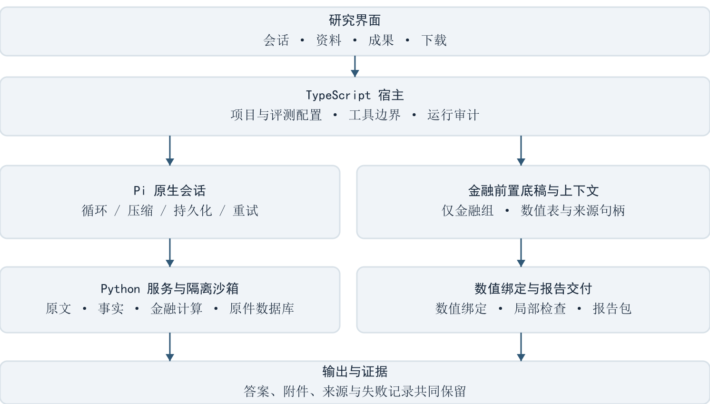
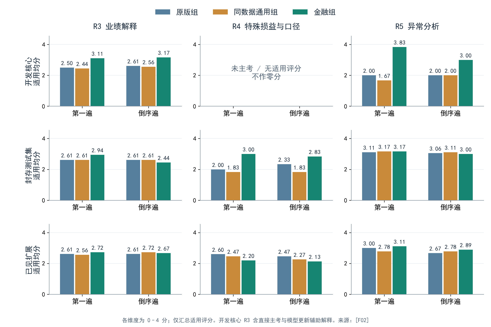
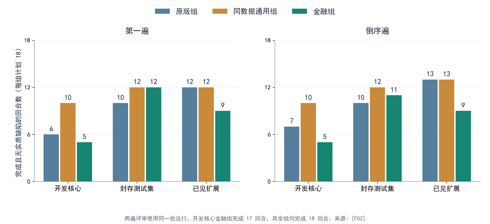
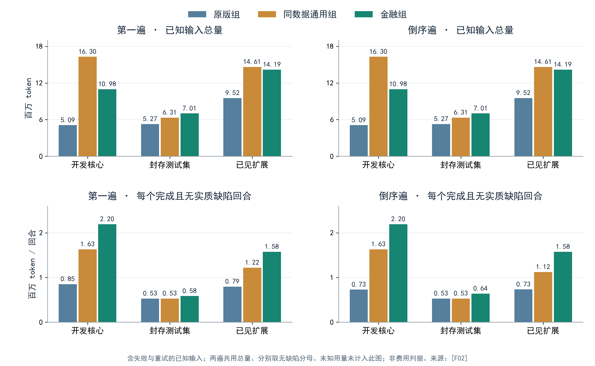

# 财报研究智能体 Finance Agent

## 从可追溯数据到底稿驱动的金融分析

**2026 北京市大学生金融人工智能竞赛 · 技术报告**

参赛队伍：【队伍】

学校、成员与指导教师：【队伍】

**让每个关键数字有来源，让每项分析判断有依据。**

Finance Agent 面向上市公司财务报告分析，连接原文资料、结构化事实、金融底稿与研究报告。系统以大语言模型承担推理，以程序完成确定性计算，以来源和版本记录支持复核与更新。

系统版本：v3。正式评测完成：162 个题位，161 个完成。[F01–F02]

### 内容导航

1 摘要　　2 问题与目标　　3 系统架构

4 v3 设计　　5 评测方法　　6 迭代过程与门槛

7 正式评测结果　　8 局限与有效性威胁　　9 后续规划

10 附录：证据索引、第三方组件、术语对照与复现说明

本文围绕“金融分析如何更准确、更深入、更易复核”展开：先介绍真实问题和系统设计，再以三组对照检验整套系统效果与金融层增量，最后说明成本、泛化及评审可靠性的边界。

<!-- pagebreak -->

## 1 摘要

Finance Agent 是面向上市公司财报分析的证据驱动智能体。系统将文档解析、结构化事实、金融计算、原文引用与报告生成连接起来，支持业绩解释、利润与现金流背离分析、会计口径比较和估值更新。大语言模型负责理解任务与解释证据，程序负责数值搬运、单位换算、公式计算和交付一致性。[S01–S02]

v3 的核心改进是底稿驱动的分析流程：宿主识别金融分析请求后，先运行财报底稿流水线，形成关键指标、变化归因、异常信号及管理层原文候选，再将紧凑结果注入模型上下文。数值表同时登记到答案绑定机制，回答与报告可直接引用计算值。交付层对无效引用、估值必要说明、瀑布图连续性和方向措辞进行检查；局部问题经过一次修复后仍未解决的，连同明确标记和有效附件交付。[S02–S04，C01–C02]

验证采用原版通用智能体、同数据通用组和金融组三组，分别评价整套系统的效果和金融层的增量。开发核心、已见扩展与封存的新公司测试集分别统计；两遍独立匿名评审按相反顺序进行，评分封存后揭盲；资料准备、参评分析和评审费用分账。[M01–M02]

**整套系统相对原版组、金融层相对通用组，在开发核心和封存测试集上的预注册 E4 均为“未证实”。** 正式评测完成 161/162 个题位，两遍独立评审显示，金融组在开发核心的业绩解释与异常分析、封存测试集的特殊损益与会计口径分析上均高于两个对照组。开发核心异常分析得分为 3.83/3.00，原版组为 2.00/2.00，通用组为 1.67/2.00；封存测试集的口径分析较原版组高 1.00/0.50 分、较通用组高 1.17/1.00 分。[F01–F02]

深度提升同时暴露了交付质量缺口。开发核心金融组两遍均有 12/18 个实质缺陷回合，通用组为 8/18；金融组已知输入较原版组高 115.62%，较通用组低 32.62%。封存测试集金融组缺陷回合为 6/18、7/18，原版组均为 8/18，但金融组已知输入高 32.94%。三类子集的缺陷有无一致率为 96.30%–98.15%，κ 为 0.9207–0.9619。下一轮聚焦材料范围、单位与币种标签、可比口径语义，使已有分析深度转化为更可靠的完整交付。[F01–F02]

关键词：财报分析；研究底稿；来源追溯；智能体；交付一致性；三组对照。

<!-- pagebreak -->

## 2 问题与目标

### 2.1 一个具体问题：利润下降，现金流为何上升？

伊利股份 2024 年年报显示，合并净利润从 102.84 亿元降至 84.64 亿元，经营活动产生的现金流量净额却从 182.90 亿元增至 217.40 亿元，增加约 34.5 亿元。两项数据均可在现金流量表补充资料中核对：PDF 第 217–218 页，对应报告印刷页 213–214。[E07]

解释这一背离，需要把净利润与减值、折旧、投资收益、递延税项及营运资本变动连接起来，再回到附注和管理层讨论寻找业务原因。研究者既要算清楚“哪些调整形成了现金差额”，也要判断“这些变化的性质和持续性”。Finance Agent 将这一过程落实为来源可查、计算可复算、解释可追问的研究链。[S01–S02]

### 2.2 面向竞赛目标的系统设计

竞赛以金融投研智能体构建为主题，上市公司财务报告分析方向关注期间计算、特殊损益、会计口径及利润与现金流背离。项目将这些要求对应到具体交付物和核验方式。[U01]

| 评审维度 | 本项目设计 | 可检查的证据 |
|---|---|---|
| 任务完成度 | 回答、图表、工作簿与报告包 | 完整交付清单 |
| 数据与计算准确性 | 原格取数、口径记录、程序计算 | 来源坐标与计算底稿 |
| 分析逻辑严密性 | 披露事实、量化影响、推论分层 | 变化归因和判断依据 |
| 证据支撑充分性 | 关键数值和解释连接原文 | 原页、原表和引用链 |
| 结果稳定性 | 重复运行、失败留存、双遍评审 | 原始运行及分歧记录 |
| 方案创新性 | 必经底稿与程序化交付 | 架构及三组对比 |
| 实际应用价值 | 资料复用、情景更新、成果导出 | 可继续使用的研究资产 |

目标用户包括财报研究人员、企业财务分析人员及教学用户。系统围绕公开财报和研报建设资料资产，并把资料准备与后续分析分开记录，为多轮研究提供可复用基础。[S01]

<!-- pagebreak -->

## 3 系统架构

### 3.1 模型推理、原生编排与金融服务分工

**核心推理引擎是可配置的大语言模型，接口兼容 OpenAI；Pi 是智能体框架。** 历史工程验证使用过国产 DeepSeek 模型；本轮正式参评统一使用模型 ID `gpt-6-luna`，主分析推理档位为 high、路由为 low，保持三组条件一致。独立评审使用 `gpt-6-astra/high`。[S01，M01，E08]

React 前端提供资料、会话、成果和下载入口；TypeScript 宿主负责项目上下文、工具边界、运行及审计；Pi 管理原生循环、上下文压缩和持久会话；Python 服务负责文档处理、事实查询与金融计算。[S01，C01]

金融分析请求先经宿主识别，运行底稿流水线，将关键结果和完整表句柄交给模型。模型据此解释经营变化，并按需补读原文或计算。交付层把计算结果、文字、图表和附件连接为报告。原版组、同数据通用组和金融组的能力配置在第 5 章统一定义。[S02，C01–C03]

<!-- pagebreak -->

### 3.2 资料、底稿与成果的连续证据链

事实记录同时保存主体、指标、期间、口径、币种、单位、维度和原文坐标。研报记录另存机构、发布日期、预测期间和观点，使公司披露、机构预测与研究判断保持清晰的身份。[S01]

| 层次 | 保存内容 | 对研究的作用 |
|---|---|---|
| 原始资料 | 原文件、页、原表及文件摘要 | 回看证据，核对版本 |
| 结构化记录 | 财务事实、研究数值、观点及口径 | 按问题取数，识别冲突 |
| 计算底稿 | 输入、参数、公式、数值表和脚本 | 复算、比较和解释差异 |
| 研究成果 | 模型版本、情景、报告与附件 | 续题、更新和跨会话复用 |
| 运行审计 | 工具事件、错误、重试及用量 | 重建执行过程与成本 |

模型修复重跑与情景更新采用不同版本语义：修复替换错误产物；情景更新保留基准与新情景，并优先交付“基准—情景—差额”比较表。表名、标签与数值共同指向版本，支持研究者解释结论为何变化。[S02]

### 3.3 半封闭环境与可恢复执行

系统采用本地原件与数据库、受控外部模型调用、隔离计算沙箱的半封闭环境。主库和密钥留在宿主侧，计算输入只读、输出独立，沙箱断网。外部模型接收任务所需的上下文；文件访问、工具调用、计算和产物生成形成审计记录。[S01，U01]

长文档按批次保存进度，记录已提交、搁置、待核和剩余表；中断后按保存的进度继续。大型附件由宿主流式下载，工具通信传递元数据或载荷句柄，连接断开后自动重建。未知写入结果保留原始错误，并通过已有进度核实，避免重复提交。[S05]

产品中的研究资产按项目共享；评测请求使用隔离键，同一题链可以复用自己的模型，其他实验链的成果不可见。原始材料与已准备数据按三组协议分配，研究产物的隔离与资料共享分别管理。[M01，C04]

<!-- pagebreak -->

## 4 v3 设计

v3 包括资料基础（P0）、底稿驱动分析（P1）、交付可靠性（P2）；上下文效率（P3）列入后续计划。[S02，S07]

### 4.1 让已有披露能被正确取用（P0）

P0 处理主体、期间、口径和指标入口之间的衔接。工具返回可用候选、失败位置与来源；程序归一确定的别名和期间，保留真正影响结论的歧义。核心查询还能够回到原表，为尚未被结构化层承接的披露提供读取路径。[S02]

| 项目 | 当前实现 | 分析中得到的结果 |
|---|---|---|
| P0.1 可行动取数 | 公司别名、期间归一、口径候选 | 清楚知道哪里有可比数据 |
| P0.2 原表读取 | 核心指标查询连接原始表格 | 可核对映射与原值 |
| P0.3 维度角色 | 在底稿读取时解释描述项与分部项 | 保存原始事实，改善取数解释 |
| P0.4 指标规范化 | 关闭事实主指标 ID 自动改写，保留只读候选 | 主指标保持原样，建议可单独复核 |
| P0.5 准备状态 | 核心已完成、待核及剩余资料分开记录 | 分析可以使用当前已准备资料 |

P0.3 只解释独立读取对象，P0.4 只保留诊断候选；提交和重新应用均保持主指标原样，原值、主体、坐标可追溯。[S06]

分析请求还可以显式选择仅使用现有资料。宿主关闭这类请求的入库入口，保留原文页、原表与事实查询，使“回答一个分析问题”和“继续准备资料”各自完成明确的任务。[M01，C01]

### 4.2 把金融底稿变成必经流程（P1.0—P1.1）

v3 将底稿从“模型可以选择调用的工具”变成金融请求的宿主前置步骤。宿主识别财报分析意图后，先运行底稿流水线，再把紧凑结果注入模型上下文。模型开始主要推理时就能看到关键指标、现金桥、异常信号和来源候选。[S02，C01]

流水线组织语义查询、指标计算与证据对齐，按问题输出分析包。关键数值、差异和缺口进入上下文，完整表通过 `read_table` 句柄读取；数值表同时进入答案登记与绑定机制（A1），供最终回答直接引用。若某个底稿步骤失败，结果显示具体失败与未完成项，其他分析继续交付。[S02，C01–C02]

| 任务意图 | 底稿入口 | 主要输出 |
|---|---|---|
| 财报总体分析 | statement_analysis | 经营指标、现金桥、季度、ROE 与特殊损益 |
| 跨期与同业比较 | period_analysis、comparison | 单季、同比、环比及可比差异 |
| 利润与现金流等异常 | anomaly_signals | 信号、来源、替代解释及跟踪项 |
| 业绩变动原因 | variance_attribution | 量化贡献与未分解残差 |
| 重述与口径变化 | basis_changes | 事项发生状态、调整和比较条件 |
| 预期差与机构预测 | expectations | 预测、实际、参考差额与版本关系 |
| 估值及情景更新 | dcf_fcf 与参数更新 | 估值、敏感性、假设及情景差额 |

这一改变直接响应了开发中观察到的采用问题：模型曾在专用工具已经存在时仍反复取数和重写计算器。前置流水线将稳定、可复算的工作先完成，为后续解释提供共同起点。[S02]

### 4.3 从披露事实走向有依据的解释（P1.2—P1.5）

**P1.2 原文对齐。** 对关键变化与异常信号，底稿提供管理层讨论或附注段落候选及来源。模型可以从数值变化跳转到相关经营说明，把“发生了什么”与“公司如何解释”连接起来。[S02]

**P1.3 三层解释。** 回答先呈现披露事实，再说明可以量化的影响，最后给出推论及条件。例如，收入和毛利率变化可以计算对毛利的贡献；产品结构的作用需要进一步引用产品数据或管理层说明。程序保留未分解残差，模型说明定性证据与量化证据各支持到哪里。[S02，C01]

未知信息分为两类：一类是“定性已披露、定量未披露”，可以引用解释并注明量化缺口；另一类是“原文未说明”，需要保留原因未知。这使回答既能利用已有说明，也能准确表达信息边界。[S02]

**P1.4 异常信号。** 每个信号连接证据、管理层解释、替代解释、持续性和后续观察项。持续性按可比期间计算；“连续”判断要求至少三个可比期间。信号由此成为可跟踪的研究问题，而不只是一个红色警告。[S02]

**P1.5 口径约束。** 同比、预期差与估值输入共同记录期间、主体、范围及会计口径。已齐口径形成可比较结果，未齐口径的差额进入参考差异表，跨版本修正通过版本链接保存。局部口径问题在相关结论旁说明。[S02]

### 4.4 系统创新的落点

本项目将金融底稿、原文对齐和交付绑定组织进同一研究流程：先让程序给出稳定数值与来源，再让模型完成方法选择、经营解释和判断。与单纯增加金融提示词相比，这一设计把关键工作落实到可重放的程序路径；与只输出计算表相比，它又保留了对业务含义、假设和替代解释的表达。[S01–S02]

三组评测分别检验这套组合的整体效果和金融层增量，形成从设计、实现到结果的验证闭环。[M01]

### 4.5 让局部问题可修复、成果可交付（P2）

确定性数值应尽量由程序直接进入报告。模型可以在回答中引用单元格占位符或嵌入整表，下载报告复用同一数值表。对具有合计关系的表，显示层调整分项舍入，使显示分项相加等于显示合计；精确值和 CSV 原精度保留，表注说明显示调整。[S01–S02]

| 交付环节 | 处理方式 | 用户得到的结果 |
|---|---|---|
| 可唯一识别的非标准引用 | 解析到已有表或图，记录改写 | 原有成果被正确引用 |
| 仍无法绑定的引用 | 一次修复后保留原文并标记 | 有效内容与问题位置一起交付 |
| 估值必要说明 | 检查假设、风险、适用范围及否定句 | 估值结论附带明确条件 |
| 方向与带符号数值 | 格式化函数加交付前检查 | 定位到具体句子、行或单元格 |

修复沿用 A1 回路；无效引用或缺失说明在最终结果中可见，已经完成的计算、图表和附件继续交付。失败记录、未解决项和每次修复的用量进入审计，方便用户接续工作。[S02，C02]

答案区分事实、推论与观点。数值绑定、来源句和用户提供信息为事实标注提供依据；缺少依据的陈述按推论或分析展示。标准报告包将本次会话的数值表与底稿组织成 Markdown、PDF 及 Excel 工作簿，覆盖异常信号、业绩归因、特殊损益与口径等章节。[C02]

### 4.6 用真实缺陷改进交付检查（F2.1 的 A/B/C 修复）

首轮门槛后，修复聚焦三个已观察到的问题，分别记为 A（口径变化标记）、B（瀑布图连续性）、C（方向检查扩面）。A 作用于金融底稿，B、C 作用于同数据通用组和金融组的共享交付层。[D01]

**A，口径变化标记。** 根据原文的期间和完成语判断事项是否发生，区分会计政策变化、会计估计变化与一般说明；对未能自动判定的候选标为未分类并保留原句。已发生的合并、重述及政策执行获得与原文对应的状态。[E04]

**B，瀑布图连续性。** `plot_runtime` 对至少三柱、存在非零 bottom 且正负变化混合的图执行端点链检查。从零或起始合计柱顶端推进，每根变化柱的一个端点连接前值，另一端点形成新值。诊断返回具体出错柱与期望位置，图片保持原样；金融工具提供 `finance_charts.waterfall` 的规范画法。[E03]

**C，方向检查扩面。** 除正文、Markdown 和 CSV 外，检查 xlsx 字符串单元格并定位到工作表和单元格；判断中英文增减的期间顺序；对同句或同表行的两个显式带符号变化值判断同向、反向关系。无法唯一解析时返回核对提示。[E03]

| 回归集合 | 规模与选择条件 | 检查结果 |
|---|---|---|
| 历史交付文本 | 70 份文件 | 错误误报 0，提示 0 |
| 工作簿扩展样本 | 2 份、92 个字符串格；至少一遍评审无实质缺陷 | 错误误报 0，提示 0 |
| 工作簿严格子集 | 1 份、43 格；两遍均无实质缺陷 | 错误误报 0，提示 0 |

回放覆盖失败原件及正确画法，真实触发与提示见第 6 章。[E03–E05]

## 5 评测方法

### 5.1 三组定义：区分系统效果与金融层增量

原版通用智能体（配置 `original_pi`，简称原版组 G）复现本项目历史 `legacy generic v0.2` 的通用提示和原文计算接口。同数据通用组（`prepared`，简称通用组 P）获得结构化资料与共享交付能力。金融组（`financial`，F）进一步获得金融工具、指导、资产及前置底稿。后文统一使用中文组名或 G/P/F。[M01，C03]

正式冻结构建为 F2.1，提交 `7e702ff`，属于本文的 v3 系统。三组使用相同模型 ID `gpt-6-luna`、推理档位与原生主循环，共享解析、隔离计算、下载、审计和传输重试。[M02，E08]

| 能力 | 原版组 G | 通用组 P | 金融组 F |
|---|---|---|---|
| 模型可见工具数 | 10 | 13 | 32 |
| 原文页表、证据搜索 | 有 | 有 | 有 |
| 结构化事实与研报记录 | 无 | 有 | 有 |
| Python、基础中文字体、下载 | 有 | 有 | 有 |
| 数值交付、绑定、修复、语义标注 | 无 | 有 | 有 |
| 绘图修整、B/C 检查 | 无 | 有 | 有 |
| 金融工具、指导与研究资产 | 无 | 无 | 有 |
| 宿主前置底稿 | 无 | 无 | 有 |

能力矩阵及工具数量通过原生请求捕获核验。原版组保留基础字体支持，关闭新增自动绘图修整；系统提示与历史配置的 SHA256 一致，完整值见附录。[E03，E06，C03]

F/G 回答“整套系统相对原版通用智能体有何改进”；F/P 回答“在同一份已准备资料和共享交付上，金融层增加了什么”。P/G 作为辅助对比，帮助理解数据与共享基础设施的作用。[M01]

### 5.2 题集、重复与封存

题集分为开发核心、已见扩展和封存的新公司测试集（held-out，以下简称封存测试集）。开发核心检验主要研究链路，扩展题检验任务覆盖，封存测试集检验新材料和新问题上的表现。封存材料与题目在评测前隔离于开发过程，报告使用对外汇总的编号与指标。[M01]

| 子集 | 题目编号 | 每题每组重复 | 三组合计计划回合 |
|---|---|---:|---:|
| 开发核心 | D1、D2→D3 | 6 | 54 |
| 已见扩展 | X1、X3、X4、X5、X6、X7 | 3 | 54 |
| 封存测试集 | BH1、BH2、BH3 | 6 | 54 |
| 合计 | 12 个题目；续题分别计回合 | 按子集安排 | 162 |

D2→D3 共用本链会话与隔离键，独立实验链使用不同键。核心与封存测试集采用全部六种组顺序；扩展采用三种拉丁式顺序。种子与排程在开跑前锁定，最多并发两个不同组题链，轮换组对。[M01–M02]

同一题目使用相同原始文件：原版组读取原文解析，通用组与金融组读取同一已准备数据快照。资料准备费用独立记录。分析请求携带只分析开关 `analysis_only`，保持评测期间的数据准备状态不变。[M01–M02]

冻结清单包含代码、提示与工具说明、原始文件及解析版本、事实快照、题目、参考、评分标准和执行次序。每条运行保存原始回答、全量附件、失败、重试与用量，形成后续复核的完整输入。[M01]

正式执行 162 个题位，完成 161 个，基础设施失败 1 个；按续题关系组织为 144 条实验链。代码、协议、排程与能力配置的冻结摘要见 F02、F03，完整交付统计见 F01。[F01–F03]

### 5.3 双遍倒序盲评与缺陷归因

每遍评审使用独立的 `gpt-6-astra/high` 上下文，输入匿名题目、完整答案、交付附件、原页参考及评分标准。第二遍改变匿名编号并反转顺序；两遍评分一起封存后揭盲。评分模型不接收组别、工具日志或前一遍结论。[M01]

| 维度 | 评价内容 |
|---|---|
| R1 读取 | 是否找到并覆盖问题所需资料 |
| R2 准确取数与计算 | 数值、期间、单位、口径及计算是否正确 |
| R3 解释业绩变化 | 是否量化并解释变化的驱动因素 |
| R4 非经常损益与会计口径 | 是否正确处理特殊损益、重述与可比范围 |
| R5 异常信号 | 信号、持续性、替代解释与跟踪判断 |
| C 结构与可追溯 | 交付一致性、来源、事实/推论/观点及假设边界 |

适用维度按 0–4 分评价，不适用记为空；实质错误使 R2 最高为 1 分。评分与缺陷原文同时保存，完成情况另行记录。[M01]

缺陷归因从最终症状向前追溯：先查来源页格与口径，再查工具输入输出和脚本，最后查文字、图表与附件渲染。由此区分金融底稿引入的问题、模型共有的解释或计算问题，以及交付基础设施覆盖不足。每个分类附带原始片段和触发位置。[D01]

揭盲后同时统计有实质缺陷的回合数和机制条数。一个机制可能在多个文件重复出现，一个回合也可能含多个机制，两者分别记账。两遍分数与分歧原文并列保留，用于解释结论的稳定性。[M01–M02]

正式评审由 18 个全新独立上下文完成，模型为 gpt-6-astra、推理档位 high；全部原始评分联合封存后统一揭盲，未追加裁决或因结果不利补跑参评。正式汇总保留两遍分歧和评审覆盖记录。[F01–F03]

### 5.4 正式判据、成本与协议修订

正式评测采用预先公开的综合判据 E4：实质缺陷回合与条目均不更多，R3/R4/R5 配对适用均分均不降低且至少一项提高，分析成本不更高。F/G 与 F/P 分别在开发核心和封存测试集判断，扩展题单列。[M01]

两轮门槛表明，评审可以对质量与深度的总体方向一致，同时在个别严重度上有分歧。正式开跑前，协议据此修订评审可靠性规则和未知用量处理；题目、参考、评分标准、重复次数与匿名化流程保持原方案。两批门槛保留当时的判定。[M02]

| 判定环节 | 正式规则 |
|---|---|
| 两遍结论 | 两遍都成立为成立；都不成立为不成立；不同为未证实 |
| 可靠性下限 | 按子集，实质缺陷有无一致率至少 80%，适用维度平均绝对差不超过 0.5 |
| 分歧披露 | 一致率、Cohen's κ、最大分差、各组分歧及原文 |
| 费用主判据 | 同价口径的配对回合费用中位数，同时披露总量 |
| 未知用量 | 以已知小计作下界，以同批同组同题最大单次观测值补未知项作上界情景 |

成本包含失败与宿主重试，准备、分析和评审分账。只有上下界情景均满足费用判据时，才报告成本条件成立。每个“完成且无实质缺陷”回答的已知输入和目录价费用作为补充指标，两遍分别计算。[M01–M02]

成本表述遵守协议：若相对原版组的成本条件不成立，则写明质量与深度结论，以及输入和费用的实际方向，不使用“更省”或“成本更低”。总费用更高时，也不以中位数单独作无条件节省表述。[M01–M02]

这些规则把稳定性和费用的不确定部分纳入报告，形成与质量结果同等可检查的证据。[M02]

## 6 迭代过程与门槛

### 6.1 首轮：从“解释更深”追到“错误为何仍在”

首轮门槛版本 F2.0.3 使用 D1、X3、X7，各组每题重复两次，共 18 回合。金融组在解释与异常分析上达到预设条件，但已完成回合中仍有 3/5 存在实质缺陷；金融组另一个回合因上游 503 失败。团队据此将下一轮工作集中于缺陷修复。[E01，D01]

| 实际缺陷 | 回合与原始表现 | 定位结果 |
|---|---|---|
| 期间颠倒 | G1_X3 写“由 8,463.7 降至 10,284.3 百万元” | 报告生成字符串把两年顺序放反 |
| 关系方向写反 | G1_X7 两项比率都下降约 3.04 个百分点，却写“方向相反” | 算出变化后，解释关系写错 |
| 瀑布图负柱错位 | F2_X3 负柱同时使用负高度与下移 bottom | 同一负变化被重复位移，累计链断开 |
| 序列错位 | P1_D1 把归母利润与经营现金流两条图序列互换 | 图和脚本的序列绑定与正确 CSV 分离 |
| 单位失配 | G1_X7 工作簿把 ROE 差额 0.39 与水平值共用“%” | 差额应标百分点，交付标签未区分 |

上述实例均来自原始交付与评审记录。[E09] 归因分成三个责任层：金融层自身的口径标记误判；各组模型共有的图形、方向和序列错误；共享交付基础设施未覆盖工作簿、期间顺序和关系断言。[D01]

下一轮把口径标记纠偏放在金融底稿中，把瀑布链与方向检查放在共享交付层，并以真实失败脚本和文本作回归。图表序列绑定等其他问题登记为后续任务，保留与本次修复范围的对应关系。[D01，E03–E04]

### 6.2 次轮：质量与指定深度在两遍中均达标

次轮冻结版本 F2.1 完成 18/18 回合。金融组的实质缺陷回合下降到第一遍 1/6、倒序遍 2/6；两个基线组仍为 3/6 至 4/6。金融组的缺陷数量、去重机制数及指定 R3/R5 深度条件，在两遍评审中均达到原门槛要求。[E02]

| 指标 | 首轮 G / P / F | 次轮 G / P / F |
|---|---|---|
| 完成回合 | 6/6、6/6、5/6 | 6/6、6/6、6/6 |
| 第一遍实质缺陷回合 | 3/6、3/6、3/5 | 3/6、3/6、1/6 |
| 倒序遍实质缺陷回合 | 3/6、4/6、3/5 | 4/6、4/6、2/6 |
| 缺陷有无双遍一致 | 17/18 | 15/18 |
| 适用维度平均绝对差 | 0.32353 | 0.38235 |
| 最大维度分差 | 2 | 2 |

来源：[E01–E02]。G 为原版组，P 为通用组，F 为金融组。首轮金融组的缺失回合单列，实质缺陷以已完成回合为分母。

| 次轮深度维度 | 金融组：第一遍 / 倒序遍 | 通用组：第一遍 / 倒序遍 |
|---|---:|---:|
| R3 解释业绩变化 | 3.167 / 2.833 | 2.333 / 2.500 |
| R4 特殊损益与口径 | 2.500 / 2.500 | 2.250 / 2.750 |
| R5 异常信号，D1/X3 主考 | 3.500 / 3.000 | 2.250 / 2.750 |

来源：[E02]。原版组 R3 两遍均为 2.500。金融组 R3、R5 均达到本轮指定深度条件；R4 倒序遍未显示金融层增量。正式 E4 按第 5 章的完整维度判断。

原门槛要求实质缺陷有无逐案一致、适用维度平均绝对差不超过 0.5、最大分差不超过 1。严格一致性未达到，费用也有未知请求，门槛总体保留未通过判定。正式评测前公开修订可靠性规则，以两遍独立结论和子集可靠性下限继续检验系统效果。[M01–M02]

### 6.3 完整记录成本、失败与修复表现

| 组别 | 首轮已知输入 token | 次轮已知输入 token | 未知请求：首轮 / 次轮 |
|---|---:|---:|---:|
| 原版组 | 1,637,538 | 2,346,651 | 0 / 0 |
| 通用组 | 3,973,147 | 3,823,832 | 0 / 0 |
| 金融组 | 2,138,475 | 2,913,088 | 1 / 1 |

来源：[E01–E02]。次轮金融组已知输入为通用组的 76.18%、原版组的 124.14%；这是输入小计而非完整费用。费用结论按第 5.4 节处理。

首轮 F2_X7 遭遇上游 503 并缺失；次轮 F2_D1 遭遇流中断，经一次自动重试完成，未知用量随尝试保留。次轮无人工补跑、无产品原因整回合失败。[E01–E02]

定向修复采用“回放命中—正确样本回归—新运行观察”的验证链。金融组在次轮两遍中均未被列出 A/B/C 对应缺陷；本批七张 X3 图采用零基线贡献柱，B 没有浮动瀑布的触发机会。C 在金融组记录 40 个去重位置，其中 2 个为确定错误记录、38 个为最终提示；36 个提示来自条件名称或元数据，另 2 个来自定性关系。一次真实方向修复将“同比减少约 -3,725.8 百万元”改为“同比变化为 -3,725.8 百万元”。[E05]

残余实质缺陷继续进入任务清单：F1_X7 将局部单期表当作全年披露边界；F1_D1 在倒序评审中被列为现金流层级归因错误。前者需要扩大披露定位，后者需要更准确地连接财务定义与解释。[E02]

评审制作过程的异常也有留存：首轮匿名化误改附件后，原评分作废，对冻结原件重制审阅包；次轮一次评审启动因提示末尾换行差异中止，在评分完成前替换。版本、作废原因和额外开销均随记录保存。[E01–E02]

<!-- pagebreak -->

## 7 正式评测结果

### 7.1 预注册结论：两项总体 E4 优势均未证实

**整套系统相对原版组、金融层相对通用组，在开发核心和封存测试集上的 E4 均为“未证实”，两遍结论相同。** 以下主表先报告预注册结果，再分别解释深度、质量与成本。分差为金融组减对照组；费用列为目录费用配对中位数比，依次列已知下界与观测上界情景；“—”为不适用。[F01–F02]

**主表一：整套系统相对原版组（F/G）**

| 子集 / 遍次 | 缺陷回合 F / 对照 | R3 / R4 / R5 分差 | 配对费用比 下 / 上 | E4 |
|---|---|---|---|---|
| 开发核心 · 第一遍 | 12 / 12 | +0.61 / — / +1.83 | 1.802 / 1.802 | 未证实 |
| 开发核心 · 倒序遍 | 12 / 11 | +0.56 / — / +1.00 | 1.802 / 1.802 | 未证实 |
| 封存测试集 · 第一遍 | 6 / 8 | +0.33 / +1.00 / +0.06 | 1.164 / 1.164 | 未证实 |
| 封存测试集 · 倒序遍 | 7 / 8 | -0.17 / +0.50 / -0.06 | 1.164 / 1.164 | 未证实 |

**主表二：金融层相对同数据通用组（F/P）**

| 子集 / 遍次 | 缺陷回合 F / 对照 | R3 / R4 / R5 分差 | 配对费用比 下 / 上 | E4 |
|---|---|---|---|---|
| 开发核心 · 第一遍 | 12 / 8 | +0.67 / — / +2.17 | 0.783 / 0.783 | 未证实 |
| 开发核心 · 倒序遍 | 12 / 8 | +0.61 / — / +1.00 | 0.783 / 0.783 | 未证实 |
| 封存测试集 · 第一遍 | 6 / 6 | +0.33 / +1.17 / +0.00 | 1.132 / 1.132 | 未证实 |
| 封存测试集 · 倒序遍 | 7 / 6 | -0.17 / +1.00 / -0.11 | 1.132 / 1.132 | 未证实 |

每组每个子集计划 18 回合。开发核心金融组有一次基础设施失败，完整参评条件未满足，且实质缺陷未减少；封存测试集的解释与异常分析未在两遍中均保持不低。费用条件与各项完整性按预注册协议共同判断。[F01–F02]

已见扩展单列：F/G 两遍均为未证实；F/P 第一遍不成立、倒序遍未证实，综合为未证实。扩展结果不抵消开发核心或封存测试集的条件缺口。[F01–F02]

<!-- pagebreak -->

### 7.2 深度：可重复的优势集中于特定分析维度

开发核心中，金融组 R3 业绩解释两遍为 3.11/3.17，高于原版组的 2.50/2.61 和通用组的 2.44/2.56；R5 异常分析为 3.83/3.00，高于原版组的 2.00/2.00 和通用组的 1.67/2.00。R4 在这一子集无适用评分，保留为空。[F02]

封存测试集中，金融组 R4 为 3.00/2.83，原版组为 2.00/2.33，通用组为 1.83/1.83；金融组相对两组分别提高 1.00/0.50、1.17/1.00 分。R3 则从第一遍较两组均高 0.33 分，变为倒序遍均低 0.17 分；R5 相对原版组为 +0.06/−0.06，相对通用组为 0.00/−0.11，方向未在两遍一致。[F01–F02]

已见扩展中，金融组 R4 为 2.20/2.13，低于原版组的 2.60/2.47 和通用组的 2.47/2.27；其他维度见图 2。开发核心 R3 汇总同时包含直接主考与模型更新的辅助解释：直接主考、辅助适用在公开 JSON 中另行分层。本文据此将发现表述为本题集的解释与异常分析提升。[F02]

<!-- pagebreak -->

### 7.3 质量：分析深度尚未转化为完整交付优势

下表两遍依次列第一遍 / 倒序遍，各列分母均为 18 个计划回合。“完成且无实质缺陷”同时要求运行完成与该遍评审无实质缺陷；失败回合不计入这一列。[F01–F02]

| 子集 | 组别 | 实质缺陷回合 | 完成且无实质缺陷 | 完成回合 |
|---|---|---|---|---|
| 开发核心 | 原版组 G | 12 / 11 | 6 / 7 | 18 |
| 开发核心 | 通用组 P | 8 / 8 | 10 / 10 | 18 |
| 开发核心 | 金融组 F | 12 / 12 | 5 / 5 | 17 |
| 封存测试集 | 原版组 G | 8 / 8 | 10 / 10 | 18 |
| 封存测试集 | 通用组 P | 6 / 6 | 12 / 12 | 18 |
| 封存测试集 | 金融组 F | 6 / 7 | 12 / 11 | 18 |
| 已见扩展 | 原版组 G | 6 / 5 | 12 / 13 | 18 |
| 已见扩展 | 通用组 P | 6 / 5 | 12 / 13 | 18 |
| 已见扩展 | 金融组 F | 9 / 9 | 9 / 9 | 18 |

开发核心金融组两遍均为 12/18 个缺陷回合，多于通用组的 8/18；完成且无实质缺陷仅 5/18。两遍金融组缺陷类别均集中于 scale（缩放，7 条）和 scope（范围，7 条）：D2 交付混入题面排除的 2025-H1 内容，D2/D3 出现亿元数标为 RMB bn、港币每股值继承人民币百万元标签。类别计数是评审机制条目，同一回合可含多类，不与回合数相加。[F01–F02]

<!-- pagebreak -->

### 7.4 成本：输入总量、合格交付投入与费用分开呈现

金融组已知输入较原版组在开发核心高 115.62%（约 +116%）、封存测试集高 32.94%（约 +33%）；较通用组在开发核心低 32.62%（约 −33%）、封存测试集高 11.17%。已见扩展分别为 +49.01%、−2.89%。下表保留原始 token 小计与未知请求，目录费用按同价规则换算。[F01–F02]

| 子集 / 组别 | 已知输入 token | 已知输出 token | 未知请求 | 目录费用 USD 下界–情景上界 |
|---|---|---|---|---|
| 开发核心 · 原版组 G | 5,092,102 | 120,915 | 0 | 0.1737–0.1737 |
| 开发核心 · 通用组 P | 16,295,386 | 138,204 | 0 | 0.4103–0.4103 |
| 开发核心 · 金融组 F | 10,979,457 | 139,139 | 2 | 0.3629–0.3867 |
| 封存测试集 · 原版组 G | 5,273,199 | 161,045 | 0 | 0.2138–0.2138 |
| 封存测试集 · 通用组 P | 6,305,756 | 135,595 | 0 | 0.2232–0.2232 |
| 封存测试集 · 金融组 F | 7,010,193 | 140,890 | 3 | 0.3217–0.4975 |
| 已见扩展 · 原版组 G | 9,522,024 | 195,587 | 2 | 0.3582–0.3940 |
| 已见扩展 · 通用组 P | 14,610,895 | 159,990 | 1 | 0.4218–0.4403 |
| 已见扩展 · 金融组 F | 14,188,674 | 205,666 | 0 | 0.4555–0.4555 |

全批分析共 1,861 次请求，其中 8 次用量未知；已知输入 89,277,686 token、输出 1,397,031 token。观测上界情景为输入 90,771,231、输出 1,433,994，目录费用合计 2.94090–3.19485 USD。已知输入包含缓存读取，reasoning 已在输出中，不重复加总。[F01–F02]

费用主判据仍采用配对回合中位数：金融组相对原版组在开发核心、封存测试集、扩展集的下界 / 上界情景比为 1.802/1.802、1.164/1.164、1.558/1.421，成本项均为不确定；相对通用组为 0.783/0.783、1.132/1.132、0.943/0.943，开发与扩展的成本项成立，封存测试集不确定。质量等其余条件仍按主表判断。[F01–F02]

资料准备、环境事故、连通性与评审单独记账。公开汇总中三份年报历史准备的已知目录费用分别为伊利 1.8671、海尔 2.2522、封存测试集年报 1.2555 USD；这些记录跨版本并含续跑，其他材料尚无完整汇总。评审用量及实付账单为未知，分析图表不混入上述准备支出。[F01]

<!-- pagebreak -->

### 7.4 成本（续）：每个完成且无实质缺陷回合的投入

图 4 上排使用同一批运行的已知总量，两遍相同；下排使用各遍“完成且无实质缺陷”的回合数作分母。所有失败与重试的已知投入均留在分子。例：开发核心金融组为 10,979,457 ÷ 5 = 2,195,891 token/回合，通用组为 16,295,386 ÷ 10 = 1,629,539 token/回合，两遍均如此。[F02]

因此，开发核心金融组虽比通用组少用约 33% 已知输入，分摊到无缺陷完成回合后投入更高。封存测试集金融组两遍为 584,183/637,290 token/回合，原版组均为 527,320，通用组均为 525,480。扩展集的各组数值见图 4。[F02]

费用采用相同分母计算：开发核心金融组两遍均为 0.0726 USD/回合，原版组为 0.0290/0.0248，通用组均为 0.0410；封存测试集分别为金融组 0.0268/0.0292、原版组 0.0214/0.0214、通用组 0.0186/0.0186。这些已知小计支持对投入产出的描述，费用主结论采用第 5.4 节的预注册判据。[F01–F02]

三张正式结果图由同一脚本从公开汇总生成，原始值、JSON 字段路径与来源摘要保存在图表数据清单中；图示取两位小数，计算保留原精度。[F04]

<!-- pagebreak -->

### 7.5 探索性观察：共享资料与交付层的作用

**非预注册、仅描述。** 通用组相对原版组的实质缺陷回合，在开发核心为 8 对 12/11，在封存测试集为 6 对 8/8；扩展集两组持平，均为 6/5。也就是说，本批资料与交付能力增强后的通用组，在两个主要子集出现了更少的错误。这提示共享结构化资料与交付基础设施本身可能贡献了错误减少；这一辅助观察不替代两项主对比的 E4 判定。[F01–F02]

### 7.6 结论：把已有深度转化为可靠交付

预注册的两项总体 E4 优势均未证实。金融层在开发核心的业绩解释、异常分析，以及封存测试集的特殊损益与会计口径分析上，带来了两遍评审均可复现的深度提升；封存测试集的 R3、R5 则未保持两遍同向。新增分析内容也带来了材料范围、单位与币种标签、可比口径语义等交付错误，局部深度优势尚未转化为完整交付优势。下一轮应针对这三类问题改进已有流程，而不是继续增加工具。[F01–F02]

### 7.7 可靠性：缺陷有无一致率为 96%–98%

| 子集 | 缺陷有无一致率 | Cohen’s κ | 适用分数平均绝对差 | 最大分差 |
|---|---|---|---|---|
| 开发核心 | 98.15% | 0.9619 | 0.2265 | 2 |
| 封存测试集 | 98.15% | 0.9607 | 0.1840 | 2 |
| 已见扩展 | 96.30% | 0.9207 | 0.2500 | 2 |

三个子集均达到预声明可靠性下限。一致回合分别为 53/54、53/54、52/54；任何维度分数或缺陷有无不同的案例分别为 38、34、41 个，二元缺陷一致率与逐项分数一致性分别报告。[F01–F02]

缺陷有无的四个分歧题位为 G3_D1、F1_BH2、G1_X3、P2_X3；保留两遍原判，不取平均、择优或追加裁决。F4_D1 的上游 503 失败保留为唯一未完成题位；倒序遍 F1_X7 的部分已交付金融叙述仍缺评审核验，计入覆盖限制。封存测试集只呈现公开编号与汇总指标。[F01–F02]

<!-- pagebreak -->

## 8 局限与有效性威胁

### 8.1 金融语义与覆盖范围

来源坐标正确不等于口径正确。主指标规范化曾在归属语境、存货计量列及表题限定上误判，因此 P0.4 在提交和重新应用路径关闭事实改写；P0.3 仅在读取对象上解释维度角色。复杂表语义和未承接披露仍是后续改进重点。[S06]

底稿量化关系、原文提供解释线索，二者并不自动证明因果。正式评测的开发核心解释分包含模型更新的辅助评分；封存测试集的 R4 优势两遍一致，但 R3、R5 不一致，扩展集金融组的 R4 较低。这些观察支持具体维度的改进，不等于完整经营归因能力或所有行业的整体领先。[F01–F02]

### 8.2 对照与评审效度

原版组复现本项目历史通用配置，并非未经适配的上游 Pi CLI。组间同时改变数据入口、工具、指导和预计算，因此比较解释为整体或金融层增量，不分离单个模块的纯因果效应。两批门槛的资料准备状态也不同，前后改善不能全部归因于一次代码修复。[M01，E01–E02]

开发题参与迭代，存在适应性偏差；封存测试集只有一家新公司，重复运行不是独立公司样本。模型评审可能共享偏差，也可能从答案风格推测组别；附件语义覆盖并非逐格穷尽。正式可靠性规则在观察门槛后修订，虽在正式开跑前公开，仍需披露这一选择。修订说明对分歧作了单位问题的概括，但详细报告还包含现金层级争议，本文按详细记录分类。[M02，E02]

### 8.3 交付、成本与应用边界

瀑布检查的真实触发机会有限，方向检查的条件名称提示存在噪声；小样本零误报不能外推总体准确率。正式评测有 202 个脚本版本复放成功、3,072 个附件链接下载成功，同时 12 个原生模型复算包因缺少 finance_model.delivery_text 失败；执行与下载成功不替代语义正确。倒序遍 F1_X7 存在关键交付评审覆盖不足。冻结 X3 参考保留原先披露的 160 元尾数说明错误，没有据此事后改分。[E03–E05，F01–F02]

三组使用相同冻结资料准备状态，已知待核事项与缺表保持原状；海尔为 338/344 张表，缺失表与 X7 必需参考输入无重叠，这一结论只适用于 X7。[F01–F02]

8 次未知请求的经验上界并非数学保证，目录价估算不等于账单；输入减少不能直接推出费用减少。并发与提供方负载影响延迟。当前是本地研究与教学系统，企业级协作和真实商业收益仍需验证；外部模型会接收必要上下文，使用时需要相应数据授权。系统创新定位于工作流与工程组合，投资判断由使用者结合证据作出。[S01，M01–M02]

<!-- pagebreak -->

## 9 后续规划

### 9.1 先修复三类交付缺陷（F2.2）

正式评测将下一轮优先级明确为已有分析链的可靠交付，修复方向如下。三类工作均由本批公开缺陷驱动，属于后续计划。[F01–F02]

| 方向 | 具体改进 | 验收重点 |
|---|---|---|
| 材料范围 | 将题面允许与排除的期间、材料范围传到预计算、底稿选择和附件生成 | D2 排除的 2025-H1 不进入仍交付成果；有效材料保持完整 |
| 单位与币种标签 | 数值与单位、币种、每股口径共同传递，换算后同步生成正文、图表、CSV 和模型包标签 | 亿元与 RMB bn、HKD/股与 RMB 百万元的真实失败回放；核验所有交付版本 |
| 可比口径语义 | 比较前明确利润归属、指标范围和调节项目；无法对齐时单列参考而非直接归因 | X5 未明确归属的预测、营业总收入与营业收入分别测试；数值接近不替代口径证据 |

验收延续“真实失败回放—正确样本回归—新任务对照”的方法，同时观察完成且无实质缺陷的回合数与 R3/R4/R5。保留已有深度，减少新增内容传播到交付中的错误。[D01，F01]

### 9.2 减少已经完成的信息搬运（P3）

按请求测量系统说明、底稿、工具结果、历史消息与重试的成本，再使用 Pi 原生上下文变换，把已消费的大块结果替换为含关键数值、来源与未决事项的摘要，附可重新读取句柄；完整资料继续保存。金融提示按实际判断职责精简，程序已接管的机械规则移出重复说明。[S02，S07]

验收同时观察输入、补读往返、续题复用、任务完成和实质缺陷，费用遵守第 5.4 节口径。正式评测中金融组相对原版组输入更高，效率改进应与交付质量共同验证。[F01–F02]

### 9.3 成果发布与应用验证

以本次三组结果形成技术报告、项目计划书、产品演示及可复现证据包。初赛作品于 10 月 18 日前提交，材料包括计划书 PDF 和介绍视频；决赛准备可运行原型、源代码、依赖说明及样例数据。[U01]

后续继续研究完整表语义下的指标契约、批次边界接收研究指令，以及报告包的独立复算完整性；扩展教学与研究试用，以人工修订、资料复用和任务完成记录评价应用价值。[S07，F01]

<!-- pagebreak -->

## 10 附录

### 10.1 证据索引：设计与实现

路径相对项目根目录，编号对应正文引用。系统冻结 commit 为 `7e702ff3f53eba8686254895ad98300445eac759`，tree 为 `9ac9fd6ca6b8b33988dffef729b3edd010677071`。[M02]

| 编号 | 文件或来源 |
|---|---|
| U01 | [北京市教委：关于举办2026年北京市大学生金融人工智能竞赛的通知](https://jw.beijing.gov.cn/gjc/tzgg_15688/202608/t20260827_4839055.html)，2026-08-27 |
| S01 | `paper/v0.3.0/finance-agent-technical-paper.md`：系统架构、数据、安全与历史验证 |
| S02 | `design/harness-v3-usable-depth-20261008.md`：v3 设计 |
| S03 | `design/f21-delivery-20261009.md`：共享交付修复 |
| S04 | `design/n2-f21-basis-markers-20261009.md`：口径标记修正 |
| S05 | `docs/evidence/f203-20261009/README.md`：附件与通信故障处理 |
| S06 | `design/f20-p04-disabled-20261009.md`：指标写入与维度解释取舍 |
| S07 | `design/followup-roadmap-20261009.md`：后续规划 |
| C01 | `server/workpaper-precompute.ts`、`server/runs.ts`、`server/financial-guidance.ts`：前置底稿和指导 |
| C02 | `server/answer-binding.ts`、`server/answer-semantics.ts`、`server/report-package.ts`、`service/delivery_text.py`：交付实现 |
| C03 | `server/original-pi.ts`、`server/original-pi-tools.json`、`tests/original-pi.test.ts`：基线契约 |
| C04 | `server/evaluation-isolation.ts`：成果隔离 |

### 10.2 原始财报核验示例

伊利现金流案例使用 `samples/native-pdf/伊利股份2024年年度报告.pdf` 第 217–218 页的补充资料。原币种人民币、单位元；计算以十进制除以一亿，展示为亿元。净利润采用补充资料中的合并净利润，与经营现金流保持同一范围。[E07]

原值、页码、文件摘要及换算结果见 `submission/report/evidence/yili-cashflow-source-check.json`。

### 10.3 证据索引：评测与数字

| 编号 | 路径与对应内容 |
|---|---|
| M01 | `benchmark/blind-eval/V3_THREE_ARM_PLAN_20261008.md`：三组、题集、评分与成本 |
| M02 | `benchmark/blind-eval/V3_PROTOCOL_REVISION_20261009.md`：正式修订与冻结 |
| D01 | `design/f203-gate-diagnosis-20261009.md`：缺陷归因与修复依据 |
| E01 | `data/evaluation/blind-eval-F203-gate-20261009/GATE_REPORT.md`：首轮全部指标与失败 |
| E02 | `data/evaluation/blind-eval-F21-gate-20261009/GATE_REPORT.md`：次轮分数、用量、分歧和覆盖 |
| E03 | `docs/evidence/f21-20261009/README.md`、`acceptance.json`、`history-replay.json`、`xlsx-history-replay.json`：离线验收 |
| E04 | `docs/evidence/n2-f21-basis-markers/README.md`、`summary.json`：口径标记回放 |
| E05 | `data/evaluation/blind-eval-F21-gate-20261009/ABC_DESCRIPTIVE_REPORT.md`：实际触发、修复和提示 |
| E06 | `docs/evidence/f202-original-pi-plot-20261009/plot-startup-capture.json`：原版绘图入口 |
| E07 | `submission/report/evidence/yili-cashflow-source-check.json` 及其指定原始 PDF：现金流示例 |
| E08 | `benchmark/blind-eval/v3-gate-plan.json`、`benchmark/blind-eval/runner-v3-formal.mjs`：模型、提供方配置与推理档位 |
| E09 | `data/evaluation/blind-eval-F203-gate-20261009/review-v4-round1-decoded.json`：五类真实缺陷实例 |
| H02 | `package.json`、`package-lock.json`、`service/requirements.txt`、`sandbox/requirements.lock`、`THIRD_PARTY_NOTICES.md`：组件 |
| F01 | `benchmark/blind-eval/F21_FORMAL_REPORT.md`：正式结论、双遍主表、缺陷说明、用量与准备费用 |
| F02 | `data/evaluation/blind-eval-F21-formal-20261009/formal-results.json`：两遍分组结果、费用情景、可靠性与能力契约 |
| F03 | `data/evaluation/blind-eval-F21-formal-20261009/protocol-freeze.json`；F02 中 protocol_files、baseline_contract：协议、排程与能力摘要 |
| F04 | `submission/report/build_result_figures.py`、`submission/report/evidence/formal-figure-data.json`：三图脚本、原值、JSON 字段路径与来源摘要 |

门槛数字直接对应汇总字段，缺失和未知单列。衍生比例以分子、分母复算，例如次轮金融组与通用组的已知输入比为 2,913,088 ÷ 3,823,832 × 100% = 76.18%。正式图表依据 F02 的结构化汇总生成；质量取 groups 下 completed_without_material_defect，深度取 scores，费用取 usage_totals 和 comparisons 中成本情景。F04 保存逐点路径，图表采用中文黑体。[E02]

### 10.4 复现路径

图表重建：`D:/anaconda/python.exe submission/report/build_result_figures.py`。PDF 重建：`D:/anaconda/python.exe submission/build_pdf.py submission/report/技术报告.md --label 技术报告 --font-size 10.5 --line-height 17`。图表只读取公开结构化汇总，使用 matplotlib 输出 PNG 和嵌入中文字体的矢量 PDF。

取得冻结代码、锁文件和授权资料快照，按模型与沙箱配置准备环境；使用封存题目、排程和隔离键运行，保存回答、附件及全尝试用量；制作两遍匿名评审包，联合封存后揭盲；按适用维度、子集和比较对象计算结果。[M01–M02]

### 10.5 第三方组件

项目自研部分包括金融数据与来源组织、宿主底稿集成、计算接口、交付约束及评测适配；下列第三方组件分别提供模型编排、通信、解析、计算和界面能力。完整依赖由锁文件和运行说明定位。[S01，H02]

| 组件 | 用途 | 版本或声明位置 |
|---|---|---|
| Pi AI / Pi coding agent | 模型调用、原生会话与上下文管理 | 声明 1.0.0；`package-lock.json` |
| MCP SDK，Node / Python | 宿主与领域服务通信 | 声明 1.32.0 / 1.26.0 |
| React、TypeScript、Vite、Express | 研究界面与宿主 | `package-lock.json` |
| dsh-annotation-core 交互实现 | 会话批注交互、定位及样式参考 | MIT；`THIRD_PARTY_NOTICES.md` |
| SQLite / FTS5 | 记录、索引与事务 | Python 环境与运行说明 |
| PyMuPDF、pdfplumber | PDF 文本、页表读取 | 声明 1.27.2.3 / 0.11.9 |
| openpyxl、xlrd | Excel 读取、工作簿及检查 | 声明 3.1.5 / 2.0.2 |
| NumPy、pandas、matplotlib | 数值计算、表格及绘图 | 服务与沙箱依赖文件 |
| RapidOCR / ONNX Runtime | 本地 OCR | 服务依赖与安装元数据 |
| LangExtract、httpx | 提取与服务请求 | `service/requirements.txt` |
| Docker / WSL | 隔离计算环境 | 沙箱配置与部署说明 |
| ReportLab | 报告 PDF 排版 | `submission/build_pdf.py` |
| 大语言模型 | 推理与独立评审 | 参评 gpt-6-luna；评审 gpt-6-astra/high [E08，M01] |

开源组件保留原许可证和来源声明。JavaScript 包的 LICENSE/NOTICE 随依赖保存，Python 包按安装元数据核对；便携运行时许可见 `THIRD_PARTY_NOTICES.md`。财报原件保留披露方版权与来源，模型采用服务接口调用。[H02]

最终发布包的组件许可证汇总、字体许可及公开材料清单：【待填】。

### 10.6 术语与代号对照

| 代号或术语 | 本文定义 |
|---|---|
| v3 / F2.1 | v3 为系统分析能力版本；F2.1 为正式评测使用的冻结构建 |
| F2.0.3 | 首轮门槛使用的构建版本 |
| original_pi / G | 原版通用智能体，复现历史 legacy generic v0.2 配置 |
| prepared / P | 同数据通用组，具备结构化资料与共享交付能力 |
| financial / F | 金融组，增加金融工具、指导、资产和前置底稿 |
| held-out | 封存的新公司测试集，正文简称封存测试集 |
| P0 | 资料基础：实体、期间、口径、原表、维度及准备状态 |
| P1.0—P1.1 | 宿主必经底稿及聚合分析流水线 |
| P1.2—P1.5 | 原文对齐、三层解释、异常持续性与口径约束 |
| P2 | 交付可靠性：引用、修复、降级、估值说明及方向检查 |
| P3 | 后续上下文效率改进 |
| F2.2 | 计划中的材料范围、单位币种标签与可比口径交付修复 |
| A1 | 数值表登记与答案绑定机制 |
| A / B / C 修复 | 口径标记 / 瀑布图连续性 / 方向检查；与评分维度 C 区分 |
| R1—R5 / C 评分 | 读取、准确性、解释、特殊损益与口径、异常；结构与可追溯 |
| E4 | 正式综合判据：质量、深度、成本及可靠性条件 |
| MCP | 模型上下文协议，用于工具通信 |
| 宿主 | 负责项目、会话运行、能力配置和审计的应用服务 |
| 底稿 | 可复算、带来源与口径的结构化分析结果 |

原版组系统提示 SHA256：`6c71fd727034260afcaa6e29e833ff27000cb7f246b2b0ffc83aa867be20c32f`。[C03，E03]

